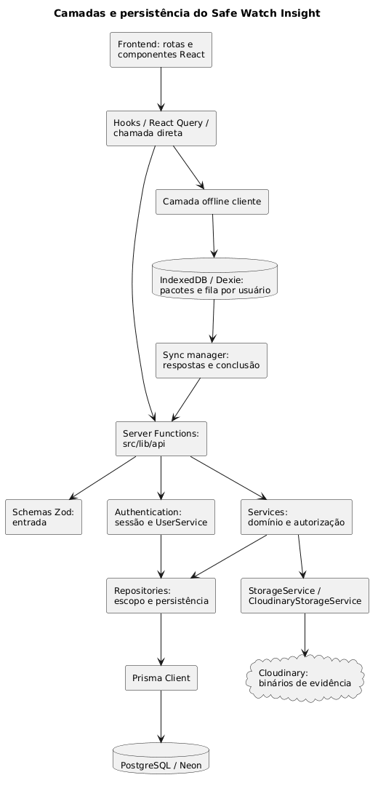
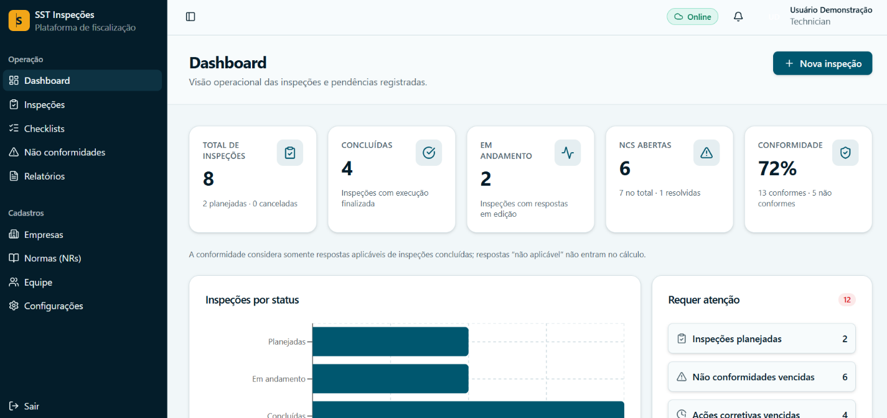
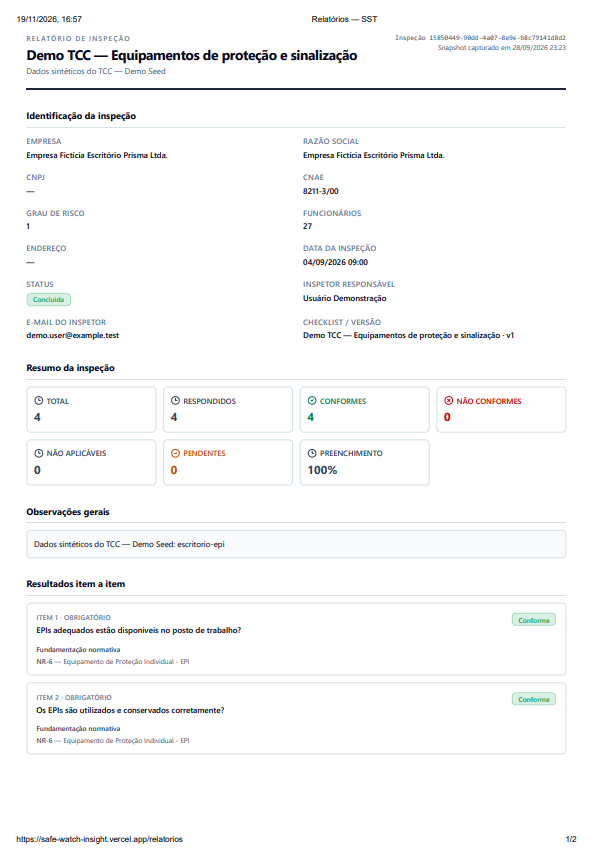
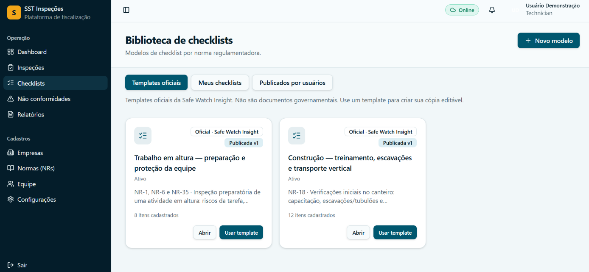
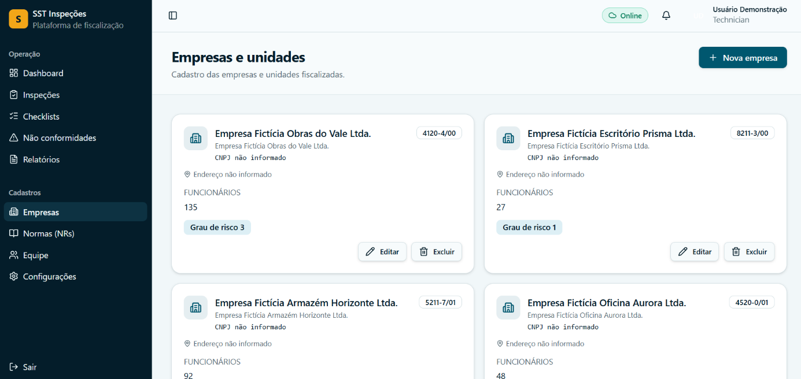
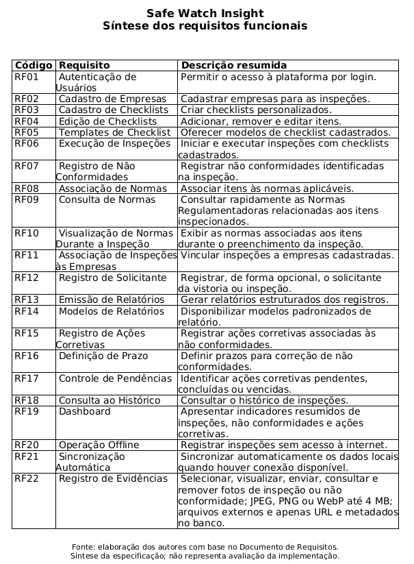
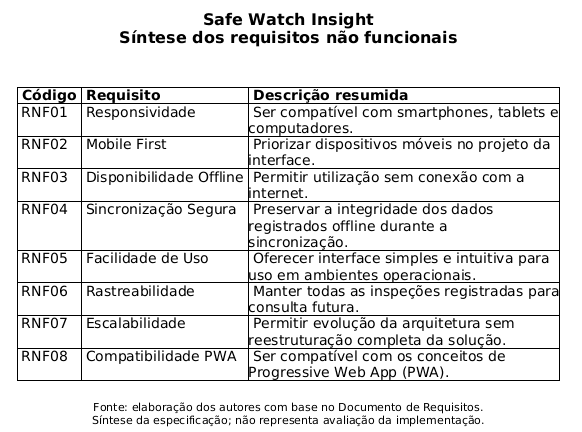
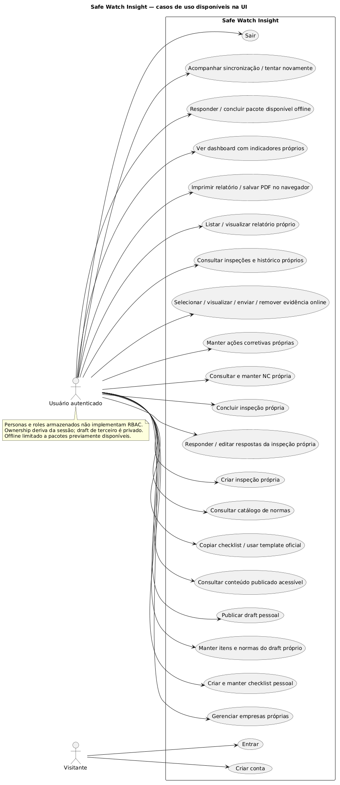
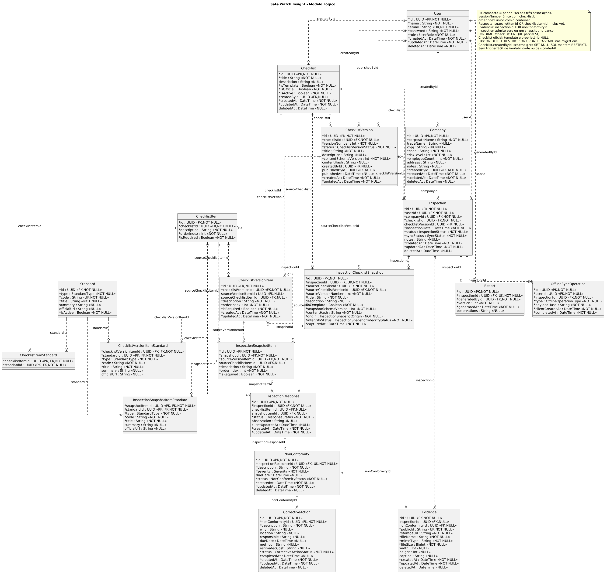
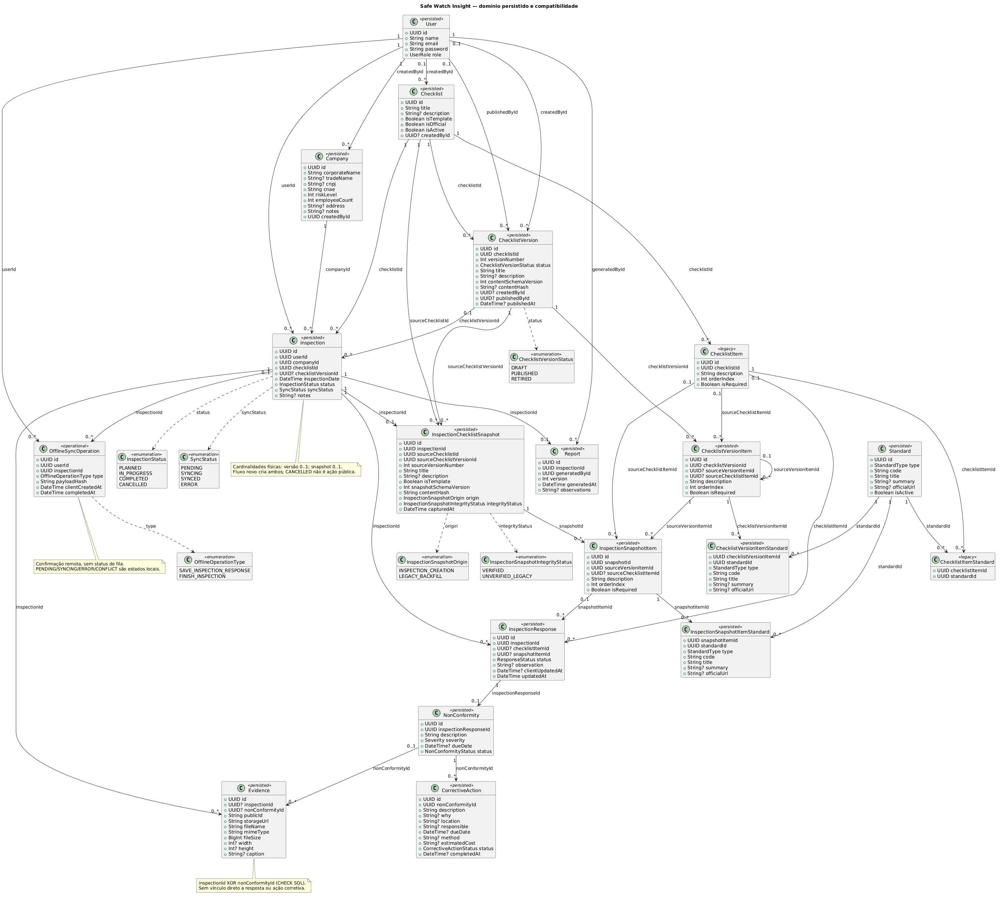

UNIVERSIDADE ESTADUAL DO MARANHÃO

PROGRAMA DE FORMAÇÃO PROFISSIONAL TECNOLÓGICA

CURSO SUPERIOR EM ANÁLISE E DESENVOLVIMENTO DE SISTEMAS

**FELIPE FERREIRA ARAÚJO**

**PEDRO VITOR SILVA DE BRITO**

**DESENVOLVIMENTO DE UMA PLATAFORMA WEB INTERATIVA PARA APOIO À SEGURANÇA DO TRABALHO**

ITAPECURU MIRIM - MA

2026

**FELIPE FERREIRA ARAÚJO**

**PEDRO VITOR SILVA DE BRITO**

**DESENVOLVIMENTO DE UMA PLATAFORMA WEB INTERATIVA PARA APOIO À SEGURANÇA DO TRABALHO**

> Monografia apresentada ao Programa PROFITEC/UEMA/Itapecuru Mirim da como parte dos requisitos necessários para obtenção do grau Tecnólogo em Análise e Desenvolvimento de Sistemas.
>
> Orientador(a): Prof(a). Me. Yonara Costa Magalhães

.

ITAPECURU MIRIM - MA

2026

# resumo

A gestão de Segurança e Saúde no Trabalho (SST) exige o monitoramento constante de riscos por meio de inspeções regulares. Contudo, o uso predominante de registros analógicos fragmenta as informações operacionais e prejudica a rastreabilidade documental. Para superar esse revés, esta pesquisa teve como objetivo desenvolver uma plataforma *web* responsiva voltada ao apoio de profissionais de SST, promovendo a digitalização e a centralização do gerenciamento dessas auditorias. De natureza aplicada e com abordagem exploratório-descritiva, o estudo apoiou-se em revisão bibliográfica e entrevistas para o levantamento de requisitos, culminando na construção do sistema sob os preceitos da Engenharia de Software.

A arquitetura da aplicação adotou o padrão *Progressive Web App* (PWA) para viabilizar a operação *offline-first*, utilizando as tecnologias *TypeScript*, *React*, *PostgreSQL* e *IndexedDB*. Na prática, a ferramenta consolida o cadastro de empresas, a gestão de *checklists* embasados nas Normas Regulamentadoras (NRs), o acompanhamento de não conformidades e a anexação de evidências fotográficas. Entre as funcionalidades implementadas, destacam-se a captura do contexto temporal dos formulários e o mecanismo de persistência local, que permite o preenchimento de dados em campo sem conexão à internet e a sua posterior sincronização com o servidor.

Submetida à avaliação de especialistas do setor, a versão preliminar obteve aprovação unânime quanto à utilidade da consulta normativa integrada, à facilidade de uso e à consistência do histórico gerado. O resultado evidencia que o sistema resolve o problema da dispersão informacional ao estruturar um fluxo digital auditável e seguro, apontando como trabalhos futuros a criação de auditorias integralmente em modo *offline* e a realização de validações operacionais mais extensas em ambientes industriais.

Palavras-chave: segurança e saúde no trabalho; inspeções de segurança; *progressive web app*; desenvolvimento de software.

# abstract

Occupational Health and Safety (OHS) management requires constant risk monitoring through regular inspections. However, the predominant use of analog records fragments operational information and hinders document traceability. To overcome this challenge, this research aimed to develop a responsive web platform designed to support OHS professionals by facilitating the digitization and centralization of audit management. The study, which is applied in nature and employs an exploratory-descriptive approach, relied on a literature review and interviews to gather requirements, culminating in the development of the system based on software engineering principles.

The application architecture utilizes the Progressive Web App (PWA) standard to enable an "offline-first" mode of operation, incorporating technologies such as TypeScript, React, PostgreSQL, and IndexedDB. In practice, the tool consolidates company registration, the management of checklists based on Regulatory Standards (NRs), the tracking of non-conformities, and the attachment of photographic evidence. Key features include the capture of temporal context for forms and a local persistence mechanism, which allows data to be entered in the field without an internet connection and subsequently synchronized with the server.

When evaluated by industry experts, the preliminary version received unanimous approval regarding the utility of its integrated regulatory reference, ease of use, and the consistency of the generated audit history. The results demonstrate that the system addresses the issue of information fragmentation by establishing a secure, auditable digital workflow. Future work will focus on enabling fully offline audits and conducting more extensive operational validation within industrial environments.

Keywords: occupational health and safety; safety inspections; progressive web app; software development.

# SUMÁRIO

- [1 INTRODUÇÃO](#secao-1) — 5
- [2 OBJETIVOS](#secao-2) — 10
  - [2.1 Objetivo geral](#secao-2-1) — 10
  - [2.2 Objetivos específicos](#secao-2-2) — 10
- [3 REFERENCIAL TEÓRICO](#secao-3) — 11
  - [3.1 Segurança e Saúde no Trabalho (SST)](#secao-3-1) — 11
  - [3.2 Normas Regulamentadoras e inspeções](#secao-3-2) — 12
  - [3.3 Transformação digital na SST](#secao-3-3) — 14
  - [3.4 Engenharia de software aplicada à solução](#secao-3-4) — 15
    - [3.4.1 Tecnologias utilizadas](#secao-3-4-1) — 17
    - [3.4.2 Trabalhos relacionados](#secao-3-4-2) — 19
- [4 METODOLOGIA](#secao-4) — 23
  - [4.1 Projeto do sistema](#secao-4-1) — 25
  - [4.2 Desenvolvimento da plataforma](#secao-4-2) — 28
- [5 RESULTADOS E DISCUSSÃO](#secao-5) — 33
- [6 CONCLUSÃO](#secao-6) — 42
- [REFERÊNCIAS](#referencias) — 44
- [aPÊNDICE A – FORMULÁRIO DE vALIDAÇÃO E LEVANTAMENTO DE Requisitos: Plataforma de SAÚDE E Segurança do Trabalho](#apendice-a) — 48
- [APÊNDICE B – Entrevista de Validação e Levantamento de Requisitos: Plataforma de SAÚDE E Segurança do Trabalho](#apendice-b) — 50
- [APÊNDICE C – Questionário de Avaliação da Plataforma Web de Apoio à Segurança do Trabalho (Teste de Protótipo)](#apendice-c) — 52
- [APÊNDICE d – requisitos funcionais do sistema](#apendice-d) — 55
- [APÊNDICE e – requisitos não funcionais do sistema](#apendice-e) — 56
- [APÊNDICE f – Casos de uso](#apendice-f) — 57
- [APÊNDICE g – modelo lógico](#apendice-g) — 58
- [APÊNDICE h – diagrama de classes](#apendice-h) — 59

# 1 INTRODUÇÃO

A Segurança e Saúde no Trabalho (SST) é fundamental para o desenvolvimento sustentável das empresas e para garantir a dignidade humana no ambiente laboral. Mais do que cumprir exigências burocráticas, estruturar um ambiente seguro reflete o compromisso ético e social com a força produtiva. Como a busca constante por produtividade e as inovações tecnológicas introduzem novos riscos operacionais, as respostas preventivas precisam ser cada vez mais sofisticadas. Sem uma gestão eficiente de SST, as consequências vão além de sanções financeiras, refletindo-se na perda de vidas e na queda da qualidade de vida dos trabalhadores.

Apesar do avanço das políticas de proteção e da consolidação de normas específicas nas últimas décadas, o Brasil ainda apresenta altos índices de doenças ocupacionais e acidentes típicos. Entre 2012 e 2021, o país registrou mais de seis milhões de acidentes de trabalho (CANTAVE; DERROSSO; REIS, 2023). Apenas no ano seguinte, o observatório SmartLab (2023) contabilizou 2.538 óbitos relacionados ao ambiente laboral. Esse volume evidencia uma grave crise de saúde pública e de gestão de riscos nos setores industrial e de serviços. Além disso, estimativas do próprio SmartLab, baseadas em dados do Instituto Nacional do Seguro Social (INSS), apontam que o Brasil ocupa a segunda posição no ranking de mortalidade ocupacional entre os países do G20. Esse cenário é agravado por uma taxa de subnotificação próxima a 21,6% no período de 2012 a 2021, o que mascara a real dimensão do problema (SMARTLAB, 2022).

Além dos acidentes, o adoecimento progressivo é um fator crítico. As Lesões por Esforços Repetitivos e os Distúrbios Osteomusculares Relacionados ao Trabalho (LER/DORT), por exemplo, representaram 11,19% de todos os benefícios concedidos pelo INSS em 2017. Essas patologias causam graves impactos biopsicossociais, muitas vezes incapacitando o trabalhador de forma permanente, e geram prejuízos ao já deficitário sistema previdenciário (BITENCOURTE, 2020). Mais do que uma questão econômica, a ocorrência de incidentes laborais fere a dignidade humana, violando direitos constitucionais fundamentais à vida, à saúde e à integridade psicofísica (EIDT, 2017). Portanto, assegurar um meio ambiente de trabalho salubre deixa de ser apenas uma demanda individual e consolida-se como um direito coletivo, que exige atuação do Estado e da sociedade.

A preocupação com os impactos do trabalho sobre o corpo humano, no entanto, não é um fenômeno recente. Registros do Antigo Egito, como o Papiro Anastasi V (cerca de 1.800 a.C.), já relatavam os males decorrentes do esforço físico severo (BARBOSA; BARSANO, 2018). Mais tarde, na Antiguidade, estudiosos como Hipócrates (ROCHA, 1999) e Plínio, o Velho (BARBOSA; BARSANO, 2018), realizaram as primeiras descrições clínicas de patologias ocupacionais. Essas observações iniciais foram essenciais para o reconhecimento de que a forma como o ser humano interage com o trabalho pode deteriorar sua própria saúde.

No âmbito global, um avanço significativo foi a criação da Organização Internacional do Trabalho (OIT), cujo objetivo central é promover oportunidades, garantir o acesso a um trabalho decente e assegurar condições de liberdade e segurança aos trabalhadores (ILO, 2007). Desde a sua fundação, a instituição atua na articulação entre governos, empregadores e sindicatos para estabelecer normas mais seguras e justas. Suas convenções e recomendações continuam ditando as diretrizes que formam a base legislativa de diversos países.

No Brasil, a regulação sobre o tema evoluiu impulsionada pelas pressões da industrialização. Após iniciativas pontuais no final do Império, como o Decreto nº 1.313/1891 (sobre o trabalho de menores), o país publicou sua primeira lei sobre o tema em 1919. O Decreto nº 3.724 passou a responsabilizar os empregadores pelos acidentes e infortúnios laborais. O grande marco, no entanto, veio na Era Vargas, com a promulgação da Consolidação das Leis do Trabalho (CLT) em 1943. A CLT estruturou as bases de proteção à integridade física do obreiro, sustentando a regulação trabalhista contemporânea (CAMISASSA, 2015).

Mais tarde, a legislação brasileira ganhou maturidade técnica com a Lei nº 6.514, de 1977, que alterou o Capítulo V da CLT e modernizou a prevenção de acidentes e a proteção à saúde ocupacional (MURBACH, 2019). Essa legislação, aliada às exigências da OIT, viabilizou a Portaria nº 3.214/1978, responsável por aprovar as primeiras Normas Regulamentadoras (NRs) (MURBACH, 2019). Com isso, orientações técnicas transformaram-se em obrigações legais para todos os empregadores regidos pela CLT.

Atualmente, as NRs representam a base da gestão de segurança no país. O Brasil dispõe de 38 normas vigentes, sendo 36 atualmente vigentes, considerando a revogação da NR-2 e da NR-27, cuja observância é obrigatória por empregadores e empregados (MTE; PEIXOTO, 2010), que variam desde diretrizes gerais, como o Gerenciamento de Riscos Ocupacionais (NR-1) e as Comissões Internas de Prevenção de Acidentes (NR-5), até orientações rigorosas para setores específicos, a exemplo da NR-18 na Construção Civil (MURBACH, 2019) e da NR-17 sobre ergonomia (BITENCOURTE, 2020). Complementando esse arcabouço, a Política Nacional de Segurança e Saúde no Trabalho (PNSST), instituída em 2011, reafirma o papel do Estado na promoção de uma cultura de prevenção contínua (CANTAVE; DERROSSO; REIS, 2023).

Apesar desse aparato legal robusto, a segurança não se materializa apenas com a publicação de normas; ela depende da atuação de profissionais especializados em campo. Nas empresas brasileiras, a estrutura responsável por essa aplicação é o Serviço Especializado em Engenharia de Segurança e em Medicina do Trabalho (SESMT), regulamentado pela NR-4 (LOPES, 2013). Atuando em conjunto com a Comissão Interna de Prevenção de Acidentes e de Assédio (CIPA), atualizada e prevista na NR-5 (OLIVEIRA, 2025), o SESMT funciona como o principal fiscalizador nas indústrias, conectando a teoria das leis à realidade dos canteiros de obras e do chão de fábrica.

A equipe do SESMT exerce funções de alta criticidade. O Engenheiro de Segurança do Trabalho atua nos níveis tático e gerencial, cuidando do planejamento, das avaliações quantitativas de riscos ambientais, da assinatura de laudos periciais e do desenho dos sistemas de gestão (SILVA *et al*., 2025). O Técnico de Segurança do Trabalho, por sua vez, opera na linha de frente, conduzindo inspeções rotineiras, Diálogos Diários de Segurança (DDS), verificação de Equipamentos de Proteção Individual (EPI) e paralisando atividades de risco iminente (LOPES, 2013). Paralelamente, os gestores de produção e a engenharia devem tomar decisões alinhadas ao SESMT, demonstrando que a segurança não é um departamento isolado, mas uma cultura transversal (LUCENA, 2019).

É nessa rotina dinâmica que a gestão da informação costuma se tornar um ponto de fragilidade. O padrão de mercado ainda é amplamente baseado no uso de papel, pranchetas e formulários impressos para o registro de inspeções (LOPES, 2013). Essa prática exige a transcrição posterior dos dados para planilhas virtuais, abrindo espaço para falhas humanas, ilegibilidade e atrasos operacionais. As consequências diretas são a perda constante de históricos, a fragmentação de documentos e a dificuldade de auditar informações com rapidez (LOPES, 2013; SILVA *et al*., 2025). Trata-se de um modelo que fomenta uma postura reativa, na qual os gestores frequentemente tomam decisões apenas após a ocorrência de um acidente (LOPES, 2013).

Diante dessas limitações, a transformação digital surge não apenas como uma facilidade administrativa, mas como um mecanismo essencial de prevenção. A digitalização das rotinas de SST muda a forma como técnicos e auditores monitoram o ambiente laboral. O uso de dispositivos móveis com aplicativos e checklists digitais permite coletar dados no local exato da inspeção (LOPES, 2013). Funcionalidades como a anexação de fotografias e a marcação de coordenadas (GPS) garantem rastreabilidade às ocorrências. Em setores complexos como a Construção Civil, essa automação acelera a geração de relatórios de não conformidades, eliminando o ciclo de retrabalho do modelo analógico (MURBACH, 2019).

Além da coleta em campo, a tecnologia permite centralizar esses dados por meio de sistemas web integrados. A exibição dessas informações em dashboards dinâmicos oferece aos engenheiros e gestores uma visão panorâmica e em tempo real dos canteiros. Os impactos dessa modernização já são descritos na literatura: a análise da implementação de um sistema piloto em uma indústria metalúrgica demonstrou uma redução de quase 50% no tempo de resposta gerencial aos riscos detectados (SILVA *et al*., 2025), confirmando que a agilidade no fluxo de dados pode efetivamente salvar vidas.

A modernização abrange também a capacitação dos operários. Tecnologias da Indústria 4.0, como ambientes de Realidade Virtual (RV) e gamificação, estão transformando as metodologias de ensino corporativo. Essas abordagens permitem que os trabalhadores vivenciem simulações de risco e internalizem protocolos de segurança de forma controlada, desenvolvendo memória técnica sem se exporem aos perigos reais de quedas ou choques (LUCENA, 2019). A digitalização da área consolida-se, portanto, como um movimento amplo, que vai desde o controle documental até a educação no chão de fábrica.

O levantamento de soluções disponíveis na literatura confirma que a informatização da SST está em fase de consolidação. Ferramentas contemporâneas atestam a viabilidade técnica da automação de relatórios e do uso de checklists padronizados. Iniciativas como o SST Hub — plataforma web focada em ampliar o acesso a conteúdos da área (MORAIS *et al*., 2026) — e o Sistema Especialista em Segurança do Trabalho (SEST) — voltado ao auxílio automatizado na tomada de decisão (TOPDJIAN *et al*., 2016) — exemplificam esse movimento. Essas aplicações provam que substituir pranchetas por tablets assegura fluidez à coleta de dados, mesmo diante das pressões da rotina industrial.

No entanto, a pesquisa bibliográfica revela lacunas práticas que merecem atenção. Grande parte das aplicações atuais apresenta limitações de usabilidade ou fragmentação das informações (MORAIS *et al*., 2026). Além disso, plataformas comerciais mais completas costumam ter custos proibitivos para micro e pequenas empresas (MPEs), ou então desvinculam o registro da auditoria do texto integral das Normas Regulamentadoras. A ausência de uma ferramenta com bom projeto de experiência do usuário (UX), que unifique consulta legal contextualizada, rastreabilidade de ações corretivas e emissão de relatórios responsivos integrados às Normas Regulamentadoras, representa uma clara oportunidade de desenvolvimento tecnológico.

A partir desse contexto, fundamenta-se o problema de pesquisa deste trabalho. O objetivo geral é desenvolver uma plataforma web responsiva para apoiar os profissionais de Segurança e Saúde no Trabalho na execução de inspeções e fiscalizações. A proposta visa digitalizar e sistematizar a coleta, o gerenciamento e o acompanhamento de dados laborais, rompendo com as limitações da gestão analógica.

Espera-se que o sistema proporcione maior agilidade e rastreabilidade às operações, elevando a auditoria a um patamar preventivo e aderente às NRs. Por fim, o projeto converge com os Objetivos de Desenvolvimento Sustentável (ODS) da ONU, especificamente ao dialogar com o ODS 3 (saúde e bem-estar) e contribuir para as metas do ODS 8 (trabalho decente e crescimento econômico), promovendo ambientes laborais mais seguros e livres de riscos iminentes.

# 2 OBJETIVOS

## 2.1 Objetivo geral

Desenvolver uma plataforma web responsiva para apoiar profissionais de Segurança e Saúde no Trabalho na realização de inspeções e fiscalizações, por meio da digitalização dos processos de coleta, gerenciamento e acompanhamento de informações, contribuindo para maior eficiência, rastreabilidade e conformidade com as Normas Regulamentadoras.

## 2.2 Objetivos específicos

Dado o objetivo geral deste trabalho, puderam ser identificados os seguintes objetivos específicos:

- Realizar um levantamento bibliográfico e tecnológico sobre Segurança e Saúde no Trabalho, inspeções, fiscalizações e soluções digitais aplicadas ao setor, identificando limitações e oportunidades de melhoria;

- Levantar os requisitos funcionais e não funcionais da plataforma, considerando as necessidades dos profissionais de Segurança e Saúde no Trabalho;

- Projetar a arquitetura e a modelagem da plataforma, contemplando banco de dados, perfis de usuários, fluxo das inspeções e mecanismos de armazenamento e sincronização das informações;

- Implementar uma plataforma web responsiva baseada em arquitetura *Progressive Web App* (PWA), com suporte a armazenamento local (*IndexedDB*) para viabilizar a persistência, o preenchimento contínuo e a sincronização posterior das respostas de inspeções, mesmo em ambientes com acesso limitado à internet;

- Avaliar a plataforma desenvolvida, por meio de questionário, quanto à sua capacidade de apoio às atividades de inspeção e fiscalização, analisando sua aderência aos requisitos definidos e sua contribuição para a melhoria da gestão das informações em Segurança e Saúde no Trabalho.

# 3 REFERENCIAL TEÓRICO

A construção de uma solução tecnológica voltada às necessidades dos profissionais de segurança do trabalho exige uma base conceitual sólida. Este capítulo fundamenta a pesquisa e estabelece a perspectiva pela qual o problema do gerenciamento de informações nas inspeções e fiscalizações é analisado. Para organizar a discussão, adotou-se o método do funil: o texto parte de uma visão ampla sobre a proteção do ambiente de trabalho e a gestão de riscos, afunilando para o papel das normas e das inspeções rotineiras. Em seguida, aborda-se a produção de dados em campo, as limitações dos processos analógicos e a transformação digital como resposta a esses gargalos. Por fim, o capítulo alinha as necessidades da área aos fundamentos da Engenharia de Software e analisa os trabalhos relacionados, evidenciando a lacuna que justifica o desenvolvimento da plataforma proposta.

## 3.1 Segurança e Saúde no Trabalho (SST)

A Segurança e Saúde no Trabalho (SST) é um campo multidisciplinar focado na preservação da integridade física, mental e social dos trabalhadores. Mais do que um conjunto de procedimentos técnicos, a área atua diretamente na garantia de um meio ambiente laboral seguro, considerado por Eidt (2017) como uma vertente indissociável do direito ao meio ambiente ecologicamente equilibrado. Trata-se da proteção de bens jurídicos essenciais: a vida, a saúde e a integridade psicofísica. Portanto, a ocorrência de doenças e acidentes ocupacionais não representa apenas uma falha produtiva, mas uma violação direta à dignidade humana (EIDT, 2017), cabendo à SST garantir que o trabalho atue como um vetor de desenvolvimento, e não de adoecimento.

Para garantir a salubridade, a SST baseia-se na prevenção e na gestão de riscos. Oliveira (2025) destaca que esse gerenciamento exige processos sistemáticos de identificação de perigos, avaliação e adoção de medidas de controle. O autor reforça que a prevenção segue uma hierarquia rigorosa: a prioridade absoluta é eliminar o risco na fonte; caso seja inviável, busca-se a minimização por meio de proteções coletivas e medidas administrativas, deixando os Equipamentos de Proteção Individual (EPIs) apenas como última barreira defensiva (OLIVEIRA, 2025). Essa dinâmica entre identificar, avaliar e controlar forma o núcleo da cultura preventiva nas organizações.

Historicamente, a forma de compreender como esses riscos se transformam em acidentes passou por diferentes modelos teóricos. Um dos mais influentes é o Modelo Causal de Perdas, formulado por Frank Bird Jr. e George Germain. Conforme discutido por Lopes (2013), esse modelo, frequentemente chamado de sequencial ou dominó, entende que as perdas não são eventos aleatórios, mas o fim de uma cadeia de falhas previsíveis. A sequência começa na "falta de controle" administrativo, que permite o surgimento de "causas básicas" (fatores pessoais ou do trabalho). Estas geram as "causas imediatas" (condições ou atos inseguros visíveis), culminando no acidente (LOPES, 2013). Nessa visão, o incidente é tratado como um sintoma de um sistema de gestão ineficaz, e não como mera fatalidade.

Contudo, a complexidade dos ambientes de trabalho modernos exigiu uma ampliação dessa visão, dando espaço às abordagens sistêmicas. O modelo de Erik Hollnagel, apresentado por Lucena (2019), argumenta que acidentes em sistemas complexos não decorrem necessariamente de uma quebra isolada de componentes, mas da variabilidade inerente ao desempenho humano e organizacional. As mesmas interações e ajustes diários que fazem a empresa funcionar podem, sob certas condições, resultar em falhas (LUCENA, 2019). A prevenção, nesse caso, não se resume a procurar uma "causa-raiz" isolada após o fato, mas a monitorar a variabilidade do ambiente e fortalecer a resiliência do sistema como um todo.

O diálogo entre essas duas perspectivas teóricas embasa o raciocínio desta pesquisa. Enquanto o modelo clássico de Bird evidencia a necessidade de estruturação e controle gerencial, a abordagem de Hollnagel alerta para a constante variabilidade e complexidade do ambiente. Fica claro, portanto, que a prevenção não pode ser um ato pontual ou exclusivamente reativo. Para suprir a falta de controle e monitorar as variações do dia a dia, as organizações precisam de mecanismos contínuos e sistemáticos de verificação. É exatamente aí que as diretrizes legais e as rotinas de inspeção se tornam ferramentas indispensáveis.

## 3.2 Normas Regulamentadoras e inspeções

No Brasil, os parâmetros técnicos e administrativos de segurança são ditados pelas Normas Regulamentadoras (NRs). Criadas para detalhar os dispositivos da Consolidação das Leis do Trabalho (CLT), as NRs são de cumprimento obrigatório pelas empresas e estruturam a forma como a prevenção deve ocorrer na prática (EIDT, 2017; MORAIS *et al*., 2026). A NR-1, por exemplo, estabelece o Programa de Gerenciamento de Riscos (PGR), exigindo inventários atualizados e planos de ação (SILVA *et al*., 2025). Normas complementares definem desde a infraestrutura preventiva — como o SESMT (NR-4) e a CIPA (NR-5) — até o controle de exposições e o uso de EPIs (MORAIS *et al*., 2026).

Para garantir que esse complexo planejamento normativo seja executado, o ambiente laboral exige avaliações constantes. É preciso, no entanto, diferenciar as atividades de fiscalização e inspeção, que possuem naturezas distintas. A fiscalização, conforme pontua Eidt (2017), é uma atividade de Estado conduzida por Auditores Fiscais do Trabalho, dotada de poder de polícia administrativa. Ela atua de fora para dentro, com caráter coercitivo e regulatório, podendo punir infrações ou adotar uma postura orientadora em pequenas empresas (EIDT, 2017).

Em contrapartida, a inspeção de segurança é um instrumento interno e proativo. Realizada pelos membros do SESMT, da CIPA ou pelas lideranças do setor, a inspeção monitora o ambiente para detectar desvios operacionais e condições inseguras antes que gerem acidentes (LOPES, 2013). Como as NRs impõem centenas de requisitos técnicos, confiar apenas na memória visual do avaliador durante as rondas é ineficaz. Surge, então, a necessidade de adotar o *checklist* (lista de verificação).

Murbach (2019) define o *checklist* como uma ferramenta estruturada para checar a aplicação prática de prescrições normativas. Ao transformar os textos densos das normas em perguntas objetivas ("A máquina possui proteção nas partes móveis?"), o instrumento permite que o profissional documente rapidamente o que está conforme e o que precisa ser ajustado. Cria-se, assim, um fluxo direto: a norma exige o requisito; a inspeção o verifica; o *checklist* documenta; e a não conformidade identificada passa a exigir monitoramento para correção (MURBACH, 2019).

Essa dinâmica leva a uma constatação central para a presente pesquisa: a partir do momento em que a equipe técnica inspeciona o ambiente rotineiramente, ela passa a gerar um volume denso e contínuo de dados. Se a gestão preventiva depende do rastreamento histórico dessas falhas e correções, a forma como essas informações são coletadas, armazenadas e recuperadas torna-se o verdadeiro diferencial para o sucesso do programa de SST.

## 3.3 Transformação digital na SST

A gestão preventiva depende, fundamentalmente, da produção e da análise de dados. As inspeções e auditorias geram informações que precisam ser transformadas em ações corretivas rápidas. Contudo, o modelo de gerenciamento tradicional tem se mostrado analógico e incompatível com a velocidade da indústria atual. Lopes (2013) destaca que a coleta de dados no chão de fábrica ainda é feita, majoritariamente, com pranchetas e formulários impressos, exigindo que o profissional arquive os documentos físicos e transcreva as informações manualmente para planilhas em computadores de mesa.

As limitações desse fluxo convencional são bem estabelecidas na literatura. A transcrição de dados abre espaço para erros e retrabalho (LOPES, 2013), enquanto o armazenamento descentralizado em planilhas isoladas dificulta o cruzamento de históricos e inviabiliza a geração de indicadores em tempo real. Pior ainda, a fragmentação prejudica a rastreabilidade: uma anotação em papel pode se perder, atrasando a correção do problema e prolongando a exposição do trabalhador ao risco. Na prática, conhecer a norma não é suficiente; a ineficiência no trânsito da informação pode comprometer todo o esforço preventivo.

Nesse cenário, a transformação digital atua como uma reconfiguração da arquitetura informacional da segurança do trabalho. A digitalização permite coletar registros diretamente na fonte, armazená-los em nuvem e gerar relatórios automaticamente, garantindo rastreabilidade desde a identificação do problema até a sua solução (SILVA *et al*., 2025). Essa mudança ataca diretamente o gargalo do modelo tradicional, convertendo dados dispersos em painéis de apoio à decisão.

A eficácia dessa transição possui comprovação empírica. Ao analisarem a implementação de um sistema informatizado para controle de riscos em uma metalúrgica, Silva *et al*. (2025) observaram que a tecnologia reduziu em quase 50% o tempo de resposta a riscos críticos, quando comparado ao método analógico anterior. Além da agilidade, a centralização dos dados melhorou a integração entre os setores operacionais e o SESMT, indicando que a tecnologia não substitui o profissional, mas potencializa sua capacidade de agir a tempo (SILVA *et al*., 2025).

Apesar dos benefícios claros, o sucesso dessas ferramentas depende de como elas se adaptam à rotina dos usuários. Técnicos e engenheiros não inspecionam canteiros de obras sentados em escritórios (MORAIS *et al*., 2026; MURBACH, 2019). Sistemas complexos, projetados apenas para monitores desktop, costumam falhar ao serem levados para o campo. Morais *et al*. (2026) ressaltam que plataformas de SST modernas exigem alto nível de responsividade, a capacidade técnica da interface de se adaptar organicamente a telas de smartphones e tablets. Aliada a isso, a usabilidade bem aplicada reduz a carga cognitiva da ferramenta, permitindo que o profissional foque sua atenção no que realmente importa: identificar o perigo no ambiente, e não lutar para preencher um software engessado.

Compreende-se, portanto, que a necessidade das empresas não é apenas documentar informações, mas dispor de um ecossistema móvel e integrado que viabilize todo o ciclo da inspeção. Para materializar essa solução de forma escalável e segura, a pesquisa fundamenta-se nos preceitos da Engenharia de Software.

## 3.4 Engenharia de software aplicada à solução

Levar processos operacionais da Segurança e Saúde no Trabalho (SST) para o ambiente digital exige extremo rigor metodológico. O desenvolvimento de ferramentas sem embasamento técnico adequado frequentemente resulta em *softwares* instáveis e vulneráveis quanto à integridade dos dados; falhas que, no contexto prevencionista, adquirem um peso crítico, pois podem comprometer o monitoramento de riscos e contribuir indiretamente para a ocorrência de acidentes. Por esse motivo, a construção da plataforma *web* proposta neste trabalho ancora-se nas bases teóricas e práticas da Engenharia de *Software*.

Guerra (2020) conceitua essa disciplina como a aplicação de abordagens sistemáticas, estruturadas e quantificáveis a todo o ciclo de vida de um sistema, abarcando desde a especificação inicial até a sua manutenção em ambiente produtivo. Para fundamentar as decisões que guiaram a construção deste projeto, destacam-se três pilares centrais da área: a engenharia de requisitos, a arquitetura e os atributos de qualidade.

O processo de construção inicia-se pela engenharia de requisitos, cuja principal função é mapear e documentar o que o sistema deverá executar (GUERRA, 2020). Em uma plataforma voltada à SST, essas exigências nascem das limitações enfrentadas em campo: a necessidade de digitalizar formulários de vistoria baseados nas Normas Regulamentadoras (NRs), garantir rotinas de acesso seguro, viabilizar a anexação de evidências fotográficas e emitir relatórios com garantia de rastreabilidade temporal. Esse alinhamento corrobora a visão de Pressman e Maxim (2016), que posicionam a engenharia de requisitos como a ponte indispensável entre a compreensão do modelo de negócio e a construção técnica do código. Trata-se de uma fase crítica: caso seja mal conduzida, o *software* resultante pode ser tecnicamente estável, porém inútil para as demandas operacionais do técnico de segurança na indústria.

O segundo pilar envolve as decisões ligadas à arquitetura de *software* (GUERRA, 2020). A opção por desenvolver uma plataforma baseada na *web*, operando sob o paradigma cliente-servidor alocado em nuvem, foi motivada pela necessidade dupla e simultânea de centralização de dados e mobilidade. Essa estrutura atende ao princípio técnico da separação de responsabilidades (MARTIN, 2019), o que significa que os mecanismos de visualização e entrega (a interface da *web*) funcionam de maneira independente das lógicas de armazenamento e segurança do banco de dados. Na prática de uma vistoria, esse desenho permite que um auditor preencha um laudo no pátio por meio de um *smartphone* e, quase instantaneamente, o gestor de segurança visualize os novos indicadores em um *dashboard* na sede corporativa, erradicando a dependência de instalações locais e de planilhas sincronizadas manualmente.

O terceiro pilar foca na garantia dos atributos de qualidade não funcionais. Características estruturais como a usabilidade, alinhada às discussões de Morais *et al.* (2026) sobre interfaces responsivas que minimizam a carga cognitiva, a confiabilidade e a manutenibilidade são imprescindíveis. Na gestão prevencionista, a exigência por dados fidedignos traduz de forma exata o conceito de confiabilidade (*dependability*) abordado por Sommerville (2011), um atributo intransigente em sistemas cujas falhas operacionais podem mascarar vulnerabilidades em ambientes físicos. É essa camada de confiabilidade que impede que o histórico de uma inspeção crítica se perca.

Em paralelo, a manutenibilidade atua como facilitadora da evolução tecnológica da ferramenta. Conforme demonstra Fowler (2019), zelar pela estrutura interna e pela legibilidade do código reduz a sua complexidade, o que minimiza o risco de novos defeitos e *bugs* durante futuras intervenções. No contexto deste projeto, um código coeso e adaptável garante que a plataforma esteja preparada para absorver futuras atualizações legais nas Normas Regulamentadoras sem que essas inserções quebrem a estabilidade das funções prévias. A Engenharia de *Software*, desta forma, funciona não apenas como um guia de programação, mas como a base científica que viabiliza a existência do projeto a longo prazo.

Entretanto, materializar um sistema funcional exige mais do que mapear as regras; requer acompanhamento rigoroso entre o que o usuário precisa, o que foi especificado e a verificação das entregas ao longo do ciclo. O corpo de conhecimento *SWEBOK* adverte sobre a diferença estrutural entre a fase inicial de levantamento de requisitos e a sua posterior gestão, que lida com o inevitável amadurecimento do entendimento sobre o problema durante as semanas de codificação (WASHIZAKI, 2026). No decorrer da construção da plataforma, essa gestão materializou-se em três atuações práticas: na documentação das necessidades do campo, na definição de regras para inserção de registros no banco e na revisão cíclica das entregas por etapas. A documentação atuou como uma âncora, orientando o desenvolvimento e esclarecendo de forma transparente as distinções entre as funcionalidades originalmente projetadas e aquelas que, de fato, alcançaram estabilidade técnica na versão avaliada.

Por fim, a etapa de verificação metodológica engloba lidar com escopos distintos de teste. Washizaki (2026) pontua que os testes unitários avaliam minúsculos fragmentos isolados de código, enquanto os testes de integração examinam se as conexões entre diferentes componentes operam sem atrito, e os testes de sistema analisam, de forma panorâmica, o comportamento final da aplicação perante o usuário. O arcabouço dessa teoria explica a abordagem adotada pela pesquisa: validar uma regra limitadora de preenchimento, averiguar se os dados estão sendo gravados no banco de dados e simular a condução de uma inspeção real diretamente pelo navegador são ações de verificação complementares. Complementando as validações sistêmicas, a avaliação conduzida junto aos participantes da pesquisa introduziu o essencial ponto de vista do uso ergonômico e humano em cenários cotidianos. Contudo, cabe ressalvar que essa avaliação complementa, mas não substitui, o rigor dos testes automatizados, tampouco confere atestado técnico irrefutável a todos os atributos de qualidade exigidos por uma ferramenta desse porte.

### 3.4.1 Tecnologias utilizadas

O desenvolvimento da plataforma baseou-se no uso de *TypeScript*, tanto na interface quanto no servidor. Isso garantiu a verificação estática de tipos, permitindo a identificação de incompatibilidades antes mesmo da execução do código (MICROSOFT, 2026). No projeto, a linguagem foi aplicada em modo estrito para definir com segurança as estruturas de dados, como empresas, *checklists*, inspeções e respostas, viabilizando o compartilhamento de contratos entre as diferentes camadas da aplicação. Porém, como os valores enviados pelo navegador precisam ser conferidos em tempo de execução, a tipagem foi complementada por uma rigorosa validação dos dados recebidos.

Para a construção da interface, optou-se pelo *React 19* (REACT, 2026). Sua arquitetura baseada em componentes facilitou a criação de elementos reutilizáveis para estruturar formulários, indicadores de situação e painéis de evidências. O visual responsivo foi organizado com o *Tailwind CSS* (TAILWIND LABS, 2026), adotando-se regras baseadas na largura da tela e uma abordagem inicial voltada a dispositivos móveis (*mobile-first*). Essa base visual foi enriquecida com a biblioteca *Radix UI* e com o pacote de ícones *Lucide*, mantendo-se íntegra durante a integração com o servidor.

A unificação entre a interface e o backend ocorreu por meio do *TanStack Start*. A ferramenta utiliza *Server Functions* para invocar operações no servidor diretamente a partir da aplicação (TANSTACK, 2026b), mecanismo escolhido para intermediar o fluxo de dados e a autenticação. A navegação, por sua vez, é gerenciada pelo *TanStack Router*. A manutenção dessa arquitetura deveu-se à decisão de aproveitar o *frontend* gerado na fase de prototipação com a ferramenta *Lovable*. Dessa forma, concentrou-se o esforço de desenvolvimento na integração das funcionalidades operacionais, evitando-se uma migração complexa de *framework* durante o prazo de entrega acadêmica.

O gerenciamento de estado, as consultas e o armazenamento temporário de dados ficaram a cargo do *TanStack React Query* (TANSTACK, 2026a). Os *hooks* da biblioteca coordenam de forma eficiente as telas de carregamento e as atualizações de interface. Nos formulários de cadastro, empregou-se o *React Hook Form* em conjunto com os esquemas da biblioteca *Zod* (ZOD, 2026). Enquanto o *Zod* garante a validação estrutural das entradas com forte integração à tipagem do *TypeScript*, ressalta-se que essa verificação ocorre em duas camadas: mesmo com as mensagens de alerta exibidas na interface, a validação no servidor permanece ativa por questões de segurança e integridade.

No que diz respeito à persistência de dados em nuvem, a plataforma adota o banco relacional *PostgreSQL*, hospedado no serviço *Neon*. A comunicação com o banco é mediada pelo *Prisma ORM 7*, que fornece um cliente de consultas e um mecanismo ágil para acompanhar as migrações estruturais do modelo (PRISMA, 2026). O modelo relacional reflete os vínculos entre empresas, inspeções, tratativas e respostas. Para assegurar a consistência dessas relações, utilizam-se as transações do *PostgreSQL* (POSTGRESQL GLOBAL DEVELOPMENT GROUP, 2026). Esse recurso garante, por exemplo, que a gravação de uma nova inspeção e do conteúdo histórico do checklist que a acompanha ocorra como uma operação única, que só é confirmada se ambas forem bem-sucedidas.

Como a inspeção em campo frequentemente ocorre em ambientes com conectividade restrita, a execução offline tornou-se um requisito. Para viabilizá-la, implementou-se o *IndexedDB* (banco de dados local do navegador) acessado por meio da biblioteca *Dexie.js* (DEXIE.JS, 2023). Diferente do cache em memória do *React Query*, o *IndexedDB* preserva os pacotes de inspeção baixados e a fila de respostas de forma persistente, garantindo que os registros locais continuem disponíveis após a página ser recarregada ou reaberta.

Esse armazenamento local opera em conjunto com os recursos de *Progressive Web App* (PWA) do sistema. O manifesto de instalação e o *service worker* interceptam requisições, permitindo que a estrutura pública e os arquivos básicos da aplicação fiquem salvos em *cache* (MDN WEB DOCS, 2026). Em paralelo, os dados sensíveis das inspeções permanecem isolados no *IndexedDB*, separados por usuário. Essa arquitetura possibilita a continuidade de inspeções previamente sincronizadas no dispositivo, ainda que nem todos os módulos da plataforma funcionem inteiramente sem rede.

Por fim, o gerenciamento de mídias (como as fotografias capturadas durante as auditorias) é realizado na plataforma *Cloudinary* (CLOUDINARY, 2026). As imagens são enviadas online por meio de chamadas autenticadas no servidor, e o *PostgreSQL* armazena apenas os metadados e os vínculos dessas mídias com as respectivas não conformidades. A aplicação final foi hospedada na *Vercel*, com o processo de *build* gerenciado pelo *Nitro*. Todo o controle de versão do código e da documentação ocorreu via *Git* e *GitHub*, assegurando a rastreabilidade das alterações e a recuperação dos marcos de desenvolvimento do projeto.

### 3.4.2 Trabalhos relacionados

Para comprovar a relevância tecnológica e científica deste projeto, é essencial analisar soluções prévias que tentaram resolver o gargalo informacional da SST. A revisão dos trabalhos relacionados ajuda a compreender o nível atual das ferramentas disponíveis, identificar padrões na comunidade acadêmica e evidenciar as limitações práticas que justificam a construção desta nova plataforma.

Murbach (2019) focou no desenvolvimento de um aplicativo móvel voltado à verificação e fiscalização da segurança. O autor comprovou que a coleta móvel de dados substitui eficientemente os antigos cadernos em canteiros de obras. A limitação da sua ferramenta, porém, está no escopo: por ser desenhada exclusivamente para os requisitos da NR-18 (Construção Civil), a solução apresenta pouca flexibilidade, não permitindo que profissionais de outros ramos industriais criem *checklists* personalizados.

Lopes (2013) foi precursor ao estudar o uso de *smartphones* para mapear condições inseguras, baseando-se no modelo de causalidade de perdas. O estudo teve o mérito de identificar o registro em papel como um problema sistêmico, sugerindo o envio de dados diretamente para o SESMT. A principal barreira desse trabalho hoje é a natural defasagem tecnológica, visto que as soluções arquiteturais e os padrões de usabilidade adotados na época já não correspondem à fluidez, integração em nuvem e responsividade exigidas pelos sistemas *web* atuais.

Em uma abordagem contemporânea e focada no mundo corporativo, Silva *et al*. (2025) criaram um sistema colaborativo de controle de riscos para o setor metalúrgico. A solução se destaca por alinhar-se à gestão macro exigida pela nova NR-1, conseguindo reduzir pela metade o tempo de resposta aos perigos mapeados na matriz de riscos da corporação. No entanto, por ser um *software* robusto voltado à estrutura interna de uma indústria pesada, a ferramenta carece de mecanismos ágeis para auditorias rápidas e generalistas — cenário comum para consultores de SST ou gestores de micro e pequenas empresas (MPEs).

Já Morais *et al*. (2026) priorizaram a acessibilidade ao desenvolverem o "SST Hub", uma plataforma *web* responsiva voltada à educação e democratização da informação normativa. O trabalho emprega excelentes conceitos de usabilidade e interface, oferecendo teias de acesso às legislações e especialistas. Sua limitação para o problema desta pesquisa, no entanto, é o caráter estritamente consultivo. O SST Hub não oferece funcionalidades operacionais em campo, como formulários de inspeção, registro *in loco* ou *dashboards* de acompanhamento de riscos.

A análise dessas iniciativas revela uma clara lacuna metodológica e tecnológica no ecossistema de soluções para a área. Observa-se que aplicativos voltados à inspeção de campo (como os de Murbach e Lopes) costumam ficar restritos a uma norma específica ou esbarram em limitações de arquiteturas legadas. Paralelamente, sistemas industriais modernos (Silva *et al*.) focam de forma densa nas matrizes de risco de grandes corporações, enquanto as ferramentas *web* mais intuitivas (Morais *et al*.) limitam-se à consulta educativa.

Falta, portanto, uma solução tecnológica equilibrada e generalista. Identifica-se a necessidade de uma plataforma que ofereça a usabilidade e a acessibilidade dos sistemas *web* responsivos modernos não apenas para fins educacionais, mas como motor ativo de gerenciamento operacional. Uma ferramenta que permita a profissionais de qualquer setor configurar e aplicar *checklists* dinâmicos baseados em múltiplas NRs em campo, garantindo armazenamento estruturado e rastreabilidade integral, sem a complexidade excessiva de *softwares* industriais pesados. É exatamente sobre essa lacuna que a presente pesquisa se posiciona, unindo a necessidade inadiável de gestão da prevenção à capacidade organizadora da Engenharia de Software contemporânea.

A análise comparativa evidencia que as soluções encontradas na literatura oferecem contribuições relevantes para a informatização de processos ligados à Segurança e Saúde no Trabalho. Porém, observa-se que a maioria dessas ferramentas foca em aspectos específicos e fragmentados do domínio. Projetos anteriores concentraram-se na disponibilização de conteúdos normativos ou no apoio à tomada de decisão, deixando uma lacuna crítica: a falta de integração prática entre o gerenciamento de inspeções de campo, o acompanhamento temporal de não conformidades, a centralização de dados em nuvem e, principalmente, a capacidade de operação em ambientes industriais com conectividade limitada.

É precisamente nesse contexto que a solução proposta neste trabalho se posiciona. O sistema desenvolvido busca consolidar essas demandas em uma única plataforma *web* responsiva, estendendo a utilidade tecnológica do escritório para o chão de fábrica e aprimorando a aplicabilidade da ferramenta em cenários reais de fiscalização.

Para fins de ilustração, ao analisarmos as ferramentas contemporâneas destacadas na literatura (SST Hub e SEST), constata-se a referida fragmentação operacional. Enquanto o SST Hub funciona como uma plataforma consultiva para acesso a conteúdos legais e o SEST oferece apoio à tomada de decisão, nenhuma das duas soluções contempla, de forma integrada, a tríade da auditoria prática: execução de inspeções via formulários dinâmicos, acompanhamento de ações corretivas e funcionamento *offline*. Ao englobar esses recursos em um mesmo ecossistema, o projeto aqui apresentado supera o escopo consultivo, atuando ativamente no gerenciamento das inspeções.

A evolução técnica que distancia a plataforma proposta das soluções correlatas pode ser observada de maneira mais clara no Quadro 1, que sintetiza as funcionalidades globais, e no Quadro 2, que destaca as escolhas tecnológicas focadas na operacionalidade em campo.

**Quadro 1 – Síntese comparativa dos trabalhos analizados**

| Critério                          | SST Hub       | SEST          | Trabalho Proposto |
|-----------------------------------|---------------|---------------|-------------------|
| Plataforma Web                    | Sim           | Não informado | Sim               |
| Interface Responsiva              | Parcial       | Não informado | Sim               |
| Funcionamento Offline             | Não           | Não           | Sim (PWA)         |
| Cadastro de Empresas              | Não           | Não           | Sim               |
| Gestão de Inspeções               | Parcial       | Sim           | Sim               |
| Gestão de Não Conformidades       | Não informado | Parcial       | Sim               |
| Consulta às NRs                   | Sim           | Parcial       | Sim               |
| Emissão de Relatórios             | Limitada      | Não informado | Sim               |
| Armazenamento Centralizado        | Sim           | Sim           | Sim               |
| Foco em Micro e Pequenas Empresas | Não informado | Não informado | Sim               |
| Código Aberto                     | Não informado | Não informado | Não               |
| Tecnologias Web Modernas          | Parcial       | Não informado | Sim               |

**Fonte:** Autores (2026)

**Quadro 2 – Diferenciais tecnológicos da plataforma**

| Critério                      | SST Hub | SEST          | Trabalho Proposto |
|-------------------------------|---------|---------------|-------------------|
| *Progressive* *Web App* (PWA) | Não     | Não           | Sim               |
| Armazenamento *Offline*       | Não     | Não           | Sim               |
| *Dashboard* Gerencial         | Não     | Não           | Sim               |
| *Checklists* Digitalizados    | Não     | Parcial       | Sim               |
| Sincronização de Dados        | Não     | Não           | Sim               |
| Arquitetura *Web* Responsiva  | Sim     | Não informado | Sim               |

**Fonte:** Autores (2026)

# 4 METODOLOGIA

Esta pesquisa possui natureza aplicada, já que se ocupa da construção de uma solução tecnológica para um problema prático e específico: a organização das informações geradas nas inspeções de Segurança e Saúde no Trabalho (SST). Em relação aos objetivos, o estudo assume um caráter exploratório durante o levantamento das necessidades dos usuários, e descritivo ao detalhar as funcionalidades da plataforma e avaliar a sua versão preliminar. Esse enquadramento metodológico apoia-se em Prodanov e Freitas (2013), que diferenciam pesquisas orientadas à aplicação prática daquelas voltadas à compreensão inicial de um fenômeno ou à mera descrição de suas características.

O percurso metodológico ocorreu entre os meses de maio e outubro de 2026. Esse período englobou a delimitação do tema, o levantamento de requisitos junto a profissionais de SST, o projeto estrutural, o desenvolvimento da plataforma, além da avaliação prática (ocorrida entre 28 e 31 de agosto) e das sucessivas revisões técnicas realizadas. É válido ressaltar que a proposta inicial do trabalho consistia em criar uma cartilha digital para consulta de normas de proteção. Contudo, o projeto foi redirecionado para o desenvolvimento de uma ferramenta móvel de apoio a inspeções em campo. Essa mudança justificou-se tanto pela viabilidade de implementação quanto pela necessidade de preservar o julgamento humano e profissional nas decisões de segurança, embora a funcionalidade de consulta ao texto das Normas Regulamentadoras tenha sido mantida e integrada ao módulo de registro das inspeções.

Para fundamentar a pesquisa, utilizou-se material bibliográfico focado em SST, gestão da informação e engenharia de software, somado à documentação oficial das tecnologias adotadas. Paralelamente, os documentos internos produzidos durante a construção do sistema (levantamento de requisitos, personas, casos de uso, modelagem de dados e registros de versionamento) serviram para basear a descrição arquitetural e atestar as entregas da equipe. Essa separação entre a revisão da literatura e a análise documental do próprio projeto segue a classificação proposta por Prodanov e Freitas (2013).

A etapa inicial de levantamento de dados envolveu profissionais com formação ou experiência direta na área de SST. Para isso, foram conduzidas entrevistas via *Google Meet* (roteiro utilizado presente no Apêndice B) e aplicado um formulário de necessidades (Apêndice A), instrumento que diferiu do questionário de avaliação utilizado na fase final. As entrevistas (três) foram conduzidas em junho de 2026, abrangendo diferentes perfis profissionais: um técnico em segurança sem atuação no mercado, um técnico atuando como docente e um gestor responsável pelo setor de SST de uma empresa. O objetivo foi mapear as ferramentas já utilizadas no mercado, entender como os registros operacionais são organizados e identificar as principais dificuldades enfrentadas durante as auditorias. Os participantes foram selecionados por conveniência, a partir dos contatos acessíveis à equipe, sem a adoção de sorteios ou exigência de representatividade estatística.

Embora os registros dessas entrevistas documentem os temas abordados e os objetivos das consultas, optou-se por não realizar transcrições literais. A síntese das demandas captadas foi complementada pelas observações empíricas dos desenvolvedores e validada no documento de requisitos. Esse levantamento qualitativo foi fundamental para estabelecer as três premissas norteadoras do projeto: centralizar informações dispersas, agilizar a recuperação de históricos de inspeção e garantir a continuidade do trabalho em ambientes com conectividade limitada.

Para avaliar a versão preliminar da plataforma aplicou-se, em agosto de 2026, um questionário composto por 14 questões, sendo 13 fechadas e uma aberta, destinado a investigar o perfil dos usuários, a frequência de realização de inspeções, a utilidade da consulta normativa integrada e do histórico de dados, além da curva de aprendizado e da rapidez percebida do sistema (Apêndice C). O instrumento também permitiu aos testadores relatar livremente os aspectos positivos, as dificuldades encontradas e suas sugestões de melhoria.

Ao todo, obteve-se o retorno de quatro avaliadores com atuações variadas a área: um estudante, um técnico, um engenheiro e um consultor/auditor de SST. Avaliou-se a clareza das mensagens da interface, a densidade visual das informações, o conforto durante o uso e a intenção de recomendação. Antes de responderem, os participantes receberam a instrução de executar o fluxo principal de uma inspeção dentro do sistema. Cabe pontuar que essa orientação garante a interação com o núcleo da ferramenta, mas não atesta que cada pessoa tenha percorrido todas as operações secundárias ou ativado rigorosamente o modo *offline*. Além disso, embora o convite para a avaliação tenha incluído profissionais consultados no início do projeto, os dois momentos da pesquisa compõem conjuntos distintos, não havendo correspondência entre os respondentes de cada fase.

Os dados oriundos das respostas fechadas foram examinados por meio de contagem simples e distribuição percentual, tendo como universo amostral os quatro respondentes. Paralelamente, os três comentários deixados na questão aberta foram lidos e categorizados conforme seus conteúdos: sugestões sobre o escopo de proteção coletiva, dúvidas sobre a localização do recurso de fotografias e impressões gerais sobre a interface. O tratamento desses dados assumiu um caráter estritamente descritivo, dispensando o uso de protocolos formais de análise de conteúdo. Também não foram realizados cruzamentos analíticos individuais entre o perfil do avaliador e suas respostas, em vista do volume reduzido de dados. A interpretação restringiu-se a relacionar a recepção da plataforma às necessidades iniciais mapeadas, sem o intuito de realizar testes de significância ou projetar inferências para toda a população de profissionais de SST.

Por fim, o ciclo de desenvolvimento foi monitorado por revisões de código, documentação e por verificações técnicas de integração e execução de regras no próprio navegador. Os resultados dessas inspeções de qualidade internas foram analisados de forma separada da avaliação feita pelos usuários. Na estruturação dos resultados deste trabalho, traçou-se uma clara distinção entre o funcionamento documentado até outubro e a experiência da versão preliminar avaliada em agosto. Dessa forma, as melhorias posteriores (como a inserção de relatórios e painéis (*dashboards*) com dados reais e os refinamentos nos controles de acesso) não foram reflexos das notas dadas pelos respondentes, mas progressão natural do desenvolvimento do *software.*

## 4.1 Projeto do sistema

O projeto foi estruturado com base no fluxo de uma inspeção real: preparar o *checklist*, vincular a atividade à empresa, registrar as respostas, identificar não conformidades e acompanhar as ações corretivas. Essa sequência permitiu conectar as necessidades mapeadas durante a pesquisa às funcionalidades da plataforma. Cada desafio operacional motivou uma solução: a dispersão de dados foi resolvida pela centralização em uma base estruturada; a dificuldade em resgatar o histórico de auditorias embasou o desenvolvimento de mecanismos de preservação de conteúdo; e a conectividade limitada em ambientes industriais orientou a adoção do armazenamento local integrado a uma posterior sincronização.

Essas premissas foram formalizadas no documento de requisitos, que reúne 22 especificações funcionais e oito não funcionais (Apêndices D e E, respectivamente ). Entre as funcionalidades principais, destacam-se o cadastro de empresas, a gestão de *checklists*, a consulta legal às normas, o registro de evidências e o acompanhamento de pendências geradas pela inspeção. Por outro lado, os requisitos não funcionais englobam aspectos de usabilidade, responsividade, rastreabilidade dos dados e suporte à continuidade operacional *offline*. É importante ressaltar que a documentação orientou o escopo, mas o atendimento a alguns itens ocorreu de forma parcial na versão entregue. A capacidade de operação integral *offline* e a geração de modelos totalmente editáveis de relatórios, por exemplo, ainda se encontram em fase de aperfeiçoamento, enquanto a inserção de campos específicos para o solicitante permaneceu apenas como um fluxo previsto para futuras iterações.

Para aproximar as decisões de *design* das rotinas práticas, foram desenvolvidas três personas: um técnico de SST, uma supervisora e um consultor externo. Embora não correspondam de forma literal aos participantes da pesquisa de campo, esses perfis fictícios ajudaram a alinhar a interface e os fluxos de acompanhamento às demandas de quem gerencia múltiplas empresas simultaneamente. Paralelamente, elaboraram-se os casos de uso para mapear as ações de visitantes e usuários autenticados, desde o *login* até a exportação do histórico (Apêndice F). Destaca-se, contudo, que embora o modelo teórico englobe diferentes papéis profissionais, o controle de acesso implementado baseia-se na propriedade sobre os registros criados (o autor do dado é o dono do dado), dispensando, nesta versão inicial, uma complexa hierarquia de permissões e equipes.

No que diz respeito à arquitetura de *software*, adotou-se a separação de responsabilidades entre a interface visual, a comunicação *client-server*, as regras de negócio e a camada de persistência. A interface emprega *hooks* e delega grande parte do controle de estado e consultas ao *React Query*. As *Server Functions* assumem o papel de intermediárias, recebendo requisições, validando a identidade do usuário e as entradas de dados, para, em seguida, direcioná-las aos serviços competentes. A camada de repositório concentra as interações com o *Prisma* e o *PostgreSQL*, aplicando filtros de propriedade e gerenciando o contexto das transações. Essa divisão arquitetural isola as regras de auditoria do acesso direto ao banco de dados pela camada de visualização, assegurando a integridade dos contratos compartilhados entre os componentes.

O ciclo de respostas e conclusão de inspeções exige, dadas as condições do campo, uma etapa essencial de persistência local. Os dados preenchidos são inicialmente gravados no banco do navegador, o *IndexedDB*, antes mesmo do envio ao servidor, independentemente da existência de conexão imediata com a *internet*. Posteriormente, um mecanismo de sincronização processa as operações retidas, cabendo ao servidor revalidar a identidade, o contexto da auditoria e lidar com potenciais conflitos de versão. O processo de autenticação, por sua vez, efetua uma chamada imediata à respectiva *Server Function*. Essa dinâmica, incluindo a gestão de arquivos fotográficos, está sintetizada na Figura 1, que ilustra como a plataforma articula o fluxo *online* com a necessidade tática de persistência local.

**FIGURA 1 — Camadas e persistência da plataforma**

**Fonte:** Autores (2026)

A modelagem do banco de dados reflete as interações de domínio entre os usuários, as empresas, os *checklists*, as inspeções, as respostas, as não conformidades, as ações corretivas e as evidências. Para estruturá-la, utilizou-se o modelo conceitual para mapear as entidades; o lógico para detalhar atributos, chaves primárias/estrangeiras e cardinalidades; e o físico para estabelecer a tipagem rigorosa e as restrições inerentes ao *PostgreSQL* (Apêndice G). O dicionário de dados atua como um guia sobre as condições de preenchimento, enquanto o diagrama de classes esclarece a estrutura hierárquica lida pela aplicação (Apêndice H).

Entre as escolhas de modelagem, uma das decisões centrais foi isolar o *checklist* base (modelo reutilizável) da versão efetivamente aplicada durante uma auditoria. Sempre que uma nova inspeção é iniciada, o sistema gera uma cópia histórica (um *snapshot*) que congela os títulos, a ordem, a exigência normativa e a formulação das perguntas naquele exato momento. Isso garante que eventuais alterações futuras no *checklist* matriz não alterem ou invalidem o histórico das respostas de inspeções passadas. Trata-se de uma duplicação controlada focada na preservação do contexto legal da avaliação, não implicando, desta forma, no congelamento irrestrito de todos os dados cadastrais ou tratativas da empresa.

Por fim, o ciclo de desenvolvimento valeu-se da etapa inicial de prototipação com a ferramenta *Lovable* para criar uma base estrutural navegável e testar fluxos de tela. Os *wireframes* gerados nessa etapa são o reflexo dos objetivos visuais iniciais e ilustram comportamentos baseados em simulações, não devendo ser interpretados como provas definitivas do atual funcionamento da aplicação final. A estratégia adotada, no entanto, foi altamente eficaz: o projeto aproveitou a casca responsiva gerada durante a prototipação e, progressivamente, substituiu os dados de demonstração (*mockups*) pelas lógicas e *endpoints* persistentes reais. Essa transição fluida conectou o *design* visual inicial à implementação do *backend* sem a necessidade de reconstruir a interface do zero a cada novo módulo desenvolvido ou desafio estrutural encontrado.

## 4.2 Desenvolvimento da plataforma

O desenvolvimento da plataforma adotou uma abordagem que priorizou entregas por conjuntos relacionados de funcionalidades. Inicialmente, a base visual do sistema foi conectada progressivamente ao servidor e ao banco de dados, começando pelos módulos de autenticação, gestão de empresas, configuração de *checklists* e rotinas de inspeção. Em seguida, foram incorporadas as opções de respostas, bases normativas, registro de não conformidades e gestão de ações corretivas. A estruturação do projeto em fases, tarefas e decisões devidamente registradas serviu como eixo norteador tanto para a execução técnica quanto para a revisão de cada entrega. Cabe ressaltar que os conteúdos sobre gestão de projetos associados ao PMBOK, abordados ao longo do curso, inspiraram a organização e a documentação inicial da pesquisa, ainda que o trabalho não pleiteie a aplicação integral do guia ou a comprovação de adoção de um método específico de gerenciamento.

Nessa dinâmica, coube aos autores a definição do escopo, das regras de negócio e a tomada de decisões de desenvolvimento, assim como a revisão de cada pacote entregue e a definição dos critérios para avanço das etapas. Como suporte operacional, ferramentas de inteligência artificial foram empregadas de forma delimitada: o *ChatGPT* auxiliou na redação de esboços de documentação e no refinamento lógico de *prompts*, enquanto o *Codex* foi utilizado para agilizar a implementação de trechos de código e colaborar em revisões técnicas específicas, acompanhadas também de intervenções manuais. Destaca-se, contudo, que o emprego dessas tecnologias esteve sempre subordinado ao crivo arquitetural dos autores e em momento algum substituiu a coleta de dados primários com os usuários ou o rigor nos critérios de verificação das funcionalidades da plataforma.

Durante a integração estrutural, os formulários da interface passaram a encaminhar seus dados diretamente para as *Server Functions*, que atuam em conjunto com serviços e repositórios. Essa comunicação incluiu a adoção de esquemas rígidos de validação antes de qualquer persistência no *PostgreSQL*. No módulo de segurança, a autenticação foi construída utilizando a sessão nativa da aplicação, assegurando que as senhas transitem e sejam armazenadas exclusivamente sob a criptografia de *hash* (padrão *bcrypt*). Ao longo da evolução do código, os controles de propriedade foram aprimorados para garantir que informações sensíveis (dados de empresas, conteúdo das inspeções e tratativas de correção) fossem acessadas apenas pelos respectivos criadores. Posteriormente, o módulo de cadastro público de novos usuários foi adicionado e integrado à rota de *login*, complementado pela devida validação de dados de entrada. Enfatiza-se que esses controles refletem os mecanismos defensivos previstos no código, sem se assumir como garantia absoluta contra todas as vulnerabilidades cibernéticas.

Na prática operacional, a execução de uma inspeção baseia-se nos itens congelados no *snapshot* do *checklist*. Caso o usuário marque um item como não conforme, o sistema exige e gera um registro associado a essa irregularidade, o qual pode ser detalhado com descrição, nível de gravidade, prazo para correção e definição de ações corretivas. Essas ações permitem a inclusão de informações clássicas de planejamento, como a motivação, o local, o responsável, a metodologia e o custo, sendo o preenchimento desses campos opcional, de acordo com as regras estabelecidas. Para que uma inspeção seja concluída pelo sistema, o usuário precisa registrar respostas para todos os itens marcados como obrigatórios, havendo a possibilidade de utilizar a opção "não aplicável" quando pertinente ao cenário. É válido notar que a existência de não conformidades (pendências) não bloqueia o encerramento do preenchimento do formulário da inspeção; pelo contrário, o acompanhamento e o saneamento dessas falhas continuam ativamente após a emissão do registro.

Em agosto, os recursos de versionamento dos *checklists* e a captura de seus históricos foram implementados, formando a base necessária para a geração posterior de relatórios e para a operação sem rede (*offline*). Os registros criados antes do funcionamento desse novo mecanismo passaram por rotinas de compatibilidade, mas, por precaução metodológica, não são tratados como reconstruções históricas absolutas nesta pesquisa. O fluxo fotográfico de evidências também foi refinado: o *upload* passou a conectar diretamente a fotografia à inspeção geral ou a uma não conformidade específica. Enquanto os arquivos brutos de imagem são enviados e mantidos *online* na plataforma *Cloudinary*, a interface oferece funcionalidades de seleção, pré-visualização, consulta e exclusão, cabendo ao *PostgreSQL* conservar apenas os metadados indispensáveis para vincular a imagem ao registro no banco.

Ainda em agosto, a equipe desenvolveu e validou o primeiro grande incremento para a operação *offline*. Quando um usuário cria uma inspeção *online* e a torna previamente disponível em seu dispositivo, ele passa a conseguir responder e concluir a auditoria localmente, com os dados persistindo em uma fila durável (*IndexedDB*). Durante essa etapa, cada registro ou alteração adquire uma identidade de operação estável, mecanismo vital para evitar duplicações caso haja instabilidade e o envio precise ser repetido pelo celular. Ao recuperar conectividade, com a aplicação ativa e a sessão ainda válida, o sincronizador entra em ação e despacha as pendências retidas na fila. Caso o servidor detecte divergências em relação à última revisão salva na base de dados principal, a escrita é bloqueada, exigindo que o usuário ou a equipe trate o conflito em vez de o sistema sobrescrever a última informação salva.

No mês de setembro, ocorreu a integração dos relatórios e dos painéis de indicadores (*dashboards*) alimentados por dados reais. O relatório unifica, em uma única visão, o contexto histórico do *checklist*, as alternativas marcadas, as não conformidades geradas, as ações apontadas e as fotografias. O processo de impressão e a geração do arquivo PDF ocorrem por meio de rotinas nativas do próprio navegador. O *dashboard*, por sua vez, foi desenhado para agregar as estatísticas de auditorias e o volume de pendências sob a responsabilidade do usuário conectado. Por fim, em outubro, a plataforma recebeu um módulo de *templates* institucionais que permite ao profissional duplicar modelos para a sua base pessoal; vale pontuar que essa designação "institucional" indica apenas que o formulário passou por curadoria técnica da equipe do projeto, não implicando, contudo, chancela governamental sobre o modelo.

Para atestar a robustez do que foi construído, os ciclos de verificação técnica abrangeram testes de integração direta contra o *PostgreSQL*, armazenamento simulado de imagens e execução de validações de regras de negócio. Adotou-se o *framework* *Playwright* executado sobre o navegador *Chromium* para automatizar e exercitar fluxos críticos, tais como a inserção de respostas *offline*, a reabertura inesperada da página e a sincronização posterior da fila. Essas rotinas operacionais foram complementadas pela rigorosa conferência de tipos (*TypeScript*) e pela geração final do artefato de construção da aplicação. Ressalta-se que o escopo dessas verificações simuladas focou no limite dos componentes locais, sendo separadas dos testes realizados contra os serviços em nuvem ou bancos de dados reais.

Todas essas camadas de revisão geraram ações corretivas na ferramenta. Ao testar a cópia de *checklists*, por exemplo, detectou-se um gargalo de processamento no serviço de nuvem Neon, o que obrigou a equipe a reescrever e agrupar as inserções (escritas em lote) e rever o fluxo. Revisões subsequentes ajustaram problemas menores, como o comportamento do sistema diante de prazos deixados em branco, o *feedback* de confirmação visual para alterações locais, o isolamento correto dos *caches* quando diferentes usuários acessam o mesmo dispositivo, e a classificação de mensagens de erro durante falhas de sincronização. Cada alteração estrutural motivou atualizações na documentação do sistema e dos cenários de teste, configurando a avaliação prática de agosto como uma etapa fundamental que continuou alimentando a evolução técnica da plataforma até o momento de recorte e finalização adotado por esta monografia em outubro.

# 5 RESULTADOS E DISCUSSÃO

O principal resultado desta pesquisa foi a entrega de uma plataforma *web* funcional para o registro e acompanhamento de inspeções de Segurança e Saúde no Trabalho (SST). Até o encerramento do desenvolvimento, o sistema contemplou o gerenciamento de empresas, a edição de *checklists*, a execução de auditorias, o registro de respostas, o acompanhamento de não conformidades, as ações corretivas e a anexação *online* de evidências fotográficas. Todo esse fluxo foi incrementado pela geração de relatórios e *dashboards* de indicadores. A entrega atinge diretamente o objetivo de digitalização proposto ao unificar registros que antes ficavam fragmentados entre pranchetas de papel, fotografias e planilhas eletrônicas (Figura 2).

**FIGURA 2 — *Dashboard***

**Fonte:** Autores (2026)

Do ponto de vista da arquitetura, a decisão de preservar cópias do *checklist* utilizado no dia da inspeção mostrou-se fundamental para a rastreabilidade do processo. Ao congelar as perguntas e as exigências normativas na criação de cada auditoria, os relatórios conseguem se conectar ao contexto original, mesmo que o modelo matriz do formulário venha a ser editado no futuro (Figura 3). Dessa forma, enquanto os dados gerais de cadastro continuam passíveis de atualização, a ferramenta resguarda o arcabouço histórico da inspeção, ainda que não constitua uma trilha de auditoria imutável (como o modelo *blockchain*) para todos os eventos da plataforma.

**FIGURA 3 — Relatório**

**Fonte:** Autores (2026)

A implementação da continuidade de operação sem rede (*offline*) atendeu de forma parcial ao problema da conectividade no campo. Nos cenários executados em agosto e setembro, foi possível iniciar uma inspeção no sistema, interromper o acesso à rede, responder ao formulário, fechar e reabrir a página e, após o restabelecimento da internet, sincronizar os dados com sucesso. Essa etapa, envolvendo operações assíncronas, teve sua persistência em nuvem conferida no servidor Neon e, posteriormente (já em outubro), complementada por simulações de concorrência em um banco de dados *PostgreSQL* local. Embora atestem a estabilidade nos ambientes testados, esses resultados não substituem uma validação exaustiva em múltiplos dispositivos e navegadores. Adicionalmente, as funções de criar novas auditorias integralmente sem conexão inicial, subir fotos em modo *offline* e automatizar resoluções de conflitos permanecem como aprimoramentos para as próximas versões.

A recepção de uma versão preliminar do sistema (anterior à integração de relatórios, *dashboards* reais e rotinas refinadas de *cache*) foi avaliada por participantes com vivência no setor entre os dias 28 e 31 de agosto de 2026. A Tabela 1 (abaixo) sintetiza as respostas às questões fechadas do instrumento de pesquisa, preservando a numeração original do formulário. Destaca-se que o universo amostral foi composto por quatro participantes, de modo que cada resposta individual corresponde a 25% da amostra. A questão de número 13, por conta da sua natureza discursiva, foi deliberadamente omitida da tabela, sendo analisada a seguir.

**Tabela 1 — Avaliação da versão preliminar da plataforma (dados coletados de 28 a 31 de agosto de 2026)**

| **Questão apresentada**                                             | **Respostas registradas**                                                                                     |
|---------------------------------------------------------------------|---------------------------------------------------------------------------------------------------------------|
| 1\. Relação com SST                                                 | Estudante: 1 (25%); técnico: 1 (25%); engenheiro: 1 (25%); consultor/auditor: 1 (25%).                        |
| 2\. Frequência de inspeções/vistorias                               | Não realiza diretamente: 1 (25%); semanalmente: 1 (25%); mensalmente: 1 (25%); ocasionalmente: 1 (25%).       |
| 3\. Utilidade da consulta às NRs durante a inspeção                 | Concordo totalmente: 4 (100%).                                                                                |
| 4\. Histórico para acompanhar pendências e evolução                 | Concordo totalmente: 4 (100%).                                                                                |
| 5\. Integração coerente das funcionalidades                         | Concordo totalmente: 3 (75%); concordo: 1 (25%).                                                              |
| 6\. Facilidade de aprender a utilizar                               | Concordo totalmente: 4 (100%).                                                                                |
| 7\. Rapidez e eficiência percebidas na realização de tarefas        | Concordo totalmente: 4 (100%).                                                                                |
| 8\. Suficiência das mensagens, retornos e indicações                | Concordo totalmente: 3 (75%); concordo: 1 (25%).                                                              |
| 9\. Adequação da quantidade de informações nas telas                | Concordo totalmente: 3 (75%); nem concordo nem discordo: 1 (25%).                                             |
| 10\. Conforto e sensação de segurança durante o uso                 | Concordo totalmente: 4 (100%).                                                                                |
| 11\. Fatores que poderiam dificultar o uso em vistoria              | Nenhuma dificuldade significativa: 2 (50%); internet: 1 (25%); necessidade de manter as mãos livres: 1 (25%). |
| 12\. Relevância para minimizar dificuldades do processo tradicional | Muito relevante: 3 (75%); moderadamente relevante: 1 (25%).                                                   |
| 14\. Probabilidade de recomendar a plataforma                       | Com certeza recomendaria: 4 (100%).                                                                           |

**Fonte:** Autores (2026)

A análise dos dados aponta um alto grau de alinhamento entre as expectativas dos profissionais e as soluções desenvolvidas. A totalidade dos participantes (100%) concordou com a utilidade da consulta normativa integrada e da disponibilidade do histórico de inspeções. Esse resultado dialoga com o problema apontado no referencial teórico: a necessidade de conectar a verificação prática em campo ao controle de tratativas posteriores. A concordância sobre a facilidade de aprendizado e a intenção de recomendar o uso do *software* comprovam a recepção favorável da usabilidade. Em paralelo a isso, aspectos de engenharia de interface, como a integração entre as telas e o *feedback* de ações, receberam avaliações positivas, mas com leves variações de intensidade (75% de concordância total contra 25% de concordância parcial).

As respostas também forneceram subsídios para futuras revisões de experiência do usuário (*UX*). Sobre a densidade informacional (questão 9), três avaliadores a consideraram plenamente adequada, enquanto um optou pela neutralidade. Embora essa posição neutra não ateste sobrecarga visual, alerta para o cuidado constante com a organização dos painéis em atualizações futuras. No que diz respeito aos obstáculos operacionais (questão 11), metade do grupo não previu dificuldades sistêmicas, porém as outras opiniões sinalizaram barreiras inerentes à rotina industrial: a ausência de internet e a necessidade tática de "manter as mãos livres". O receio justificado em relação à falta de rede comprova a adequação da estratégia de engenharia de investir na capacidade *offline* do aplicativo, mesmo não sendo possível confirmar, por este formulário, se todos os respondentes chegaram a forçar o funcionamento dessa contingência durante o teste.

Na pergunta discursiva (questão 13), dedicada ao mapeamento livre de pontos fortes, fracos e sugestões, obteve-se adesão de 75% da amostra. Um dos comentários destacou a intuitividade da ferramenta e a facilidade de aprendizado durante sua utilização. Por outro lado, o relato de uma dificuldade passageira em encontrar o botão para o *upload* das fotografias não invalida a presença da funcionalidade, mas indica uma falha de "descobrimento". Esse apontamento será útil para nortear uma reformulação na disposição e no destaque desse elemento na tela da auditoria. Por fim, uma sugestão valiosa abordou a inclusão de lógicas voltadas aos Equipamentos de Proteção Coletiva (EPCs); esse *feedback* destaca a necessidade de validar o conteúdo dos formulários junto aos gestores de SST no mercado, sem implicar, desta forma, que o algoritmo da plataforma deva ser o único responsável por inferir ou decidir automaticamente os arranjos de segurança de uma planta industrial.

A avaliação positiva realizada pelos participantes é um resultado importante, pois fornece evidências iniciais de que a plataforma atende às necessidades do público-alvo e apresenta potencial para aplicação prática. Esse resultado contribui para a resolução do problema de pesquisa ao indicar que a solução desenvolvida pode facilitar a execução das inspeções e o acompanhamento das informações relacionadas à SST. Além disso, os achados corroboram a literatura sobre desenvolvimento de sistemas centrados no usuário, segundo a qual a percepção de utilidade e facilidade de uso constitui fator fundamental para a adoção de novas tecnologias em ambientes organizacionais.

A implementação dos mecanismos de funcionamento offline representa um resultado relevante, pois amplia a aplicabilidade da ferramenta em cenários nos quais a conectividade com a internet é limitada ou inexistente. Essa característica contribui diretamente para solucionar uma das dificuldades encontradas em inspeções de campo, garantindo a continuidade das atividades sem interrupções operacionais. Do ponto de vista da literatura, o resultado reforça a utilização de aplicações web progressivas como alternativa para aumentar a disponibilidade e a confiabilidade de sistemas móveis, além de representar um diferencial em relação às soluções analisadas durante a pesquisa.

A análise comparativa da solução desenvolvida em relação aos trabalhos e ferramentas identificados na literatura permite evidenciar contribuições relevantes. Diferentemente do SST Hub, cuja proposta está voltada principalmente para a disponibilização e consulta de informações relacionadas à Segurança e Saúde no Trabalho, a plataforma desenvolvida incorpora funcionalidades operacionais que apoiam diretamente a execução e o gerenciamento das inspeções, incluindo o registro de não conformidades, o acompanhamento de ações corretivas e a emissão de relatórios. Além disso, a solução amplia a proposta apresentada por Murbach (2019), ao possibilitar a criação e utilização de múltiplos checklists adaptados a diferentes contextos organizacionais e demandas de inspeção, conferindo maior flexibilidade ao processo de avaliação (Figura 4). Outro diferencial observado é a disponibilização de recursos de funcionamento offline, permitindo a continuidade das inspeções mesmo em ambientes com conectividade limitada ou inexistente, característica não identificada nas soluções analisadas durante a revisão da literatura. Por fim, a plataforma integra, em um único ambiente, funcionalidades de consulta normativa, realização de inspeções, registro de evidências, acompanhamento de não conformidades e monitoramento de ações corretivas, reduzindo a necessidade de utilização de múltiplas ferramentas e contribuindo para maior eficiência na gestão das atividades de Segurança e Saúde no Trabalho.

**FIGURA 4 — Checklist**

**Fonte:** Autores (2026)

Os resultados obtidos demonstram o atendimento dos objetivos específicos estabelecidos nesta pesquisa. O levantamento bibliográfico e tecnológico permitiu identificar as principais limitações dos processos tradicionais de inspeção em Segurança e Saúde no Trabalho, bem como as lacunas existentes nas soluções encontradas na literatura. O processo de elicitação de requisitos, realizado por meio de entrevistas e formulários aplicados a profissionais da área, possibilitou a definição dos requisitos funcionais e não funcionais que nortearam o desenvolvimento da solução. Em seguida, a modelagem da arquitetura, do banco de dados e dos fluxos operacionais forneceu a base para a implementação da plataforma web responsiva. Como resultado, foi desenvolvida uma aplicação capaz de gerenciar empresas, checklists, inspeções, não conformidades, ações corretivas e relatórios, incorporando ainda mecanismos de persistência local e sincronização de dados (Figura 3). Por fim, a avaliação conduzida junto aos usuários indicou percepção positiva quanto à utilidade, facilidade de uso e potencial de aplicação da ferramenta, evidenciando a aderência da solução aos requisitos inicialmente definidos e aos objetivos propostos para o trabalho.

**FIGURA 5 — Cadastro de empresas**

**Fonte:** Autores (2026)

Além da contribuição tecnológica materializada na implementação da plataforma, esta pesquisa também apresenta uma contribuição acadêmica ao sistematizar requisitos, funcionalidades e desafios associados à digitalização de inspeções de Segurança e Saúde no Trabalho. O estudo consolida evidências obtidas na literatura e junto aos profissionais da área, oferecendo uma referência para futuras pesquisas sobre aplicações web progressivas voltadas à gestão de SST e à realização de inspeções em campo.

Apesar dos resultados positivos obtidos na avaliação da plataforma, algumas limitações devem ser consideradas na interpretação dos achados. A validação foi realizada com um número reduzido de participantes, o que restringe a representatividade da amostra e limita a extrapolação dos resultados para diferentes contextos organizacionais e perfis de usuários. Dessa forma, os resultados apresentados devem ser compreendidos como evidências preliminares do potencial da solução, não sendo possível generalizar as conclusões para todo o contexto da Segurança e Saúde no Trabalho. Além disso, a avaliação foi conduzida em ambiente controlado, sem a utilização prolongada da plataforma em cenários industriais reais, nos quais fatores como volume de dados, condições operacionais, infraestrutura tecnológica e dinâmica das inspeções pode influenciar a experiência de uso e o desempenho da ferramenta. Outra limitação refere-se à ausência da aplicação de instrumentos padronizados de avaliação de usabilidade e aceitação tecnológica, como o *System Usability Scale* (SUS), o *User Experience Questionnaire* (UEQ) e o *Technology Acceptance Model* (TAM). A utilização desses métodos poderia fornecer indicadores quantitativos mais robustos sobre usabilidade, experiência do usuário e intenção de adoção da plataforma. Nesse sentido, recomenda-se que estudos futuros ampliem o número de participantes, realizem avaliações em ambientes industriais reais e empreguem métricas consolidadas na literatura, permitindo uma análise mais abrangente e confiável da efetividade da solução proposta.

A convergência entre os cenários de testes técnicos e as impressões positivas extraídas da validação atesta o potencial e a viabilidade da ferramenta proposta. Contudo, é prudente esclarecer os limites dessas conclusões. Como a pesquisa não quantificou indicadores cronometrados de eficiência (como a redução real de acidentes de trabalho, impacto sobre multas legais ou diminuição exata de minutos gastos por inspeção), as respostas favoráveis nos campos de "rapidez" e "sensação de segurança" traduzem a percepção ergonômica e cognitiva dos envolvidos, e não uma métrica oficial de engenharia de métodos. Soma-se a isso a limitação analítica imposta pela apresentação anonimizada dos dados, o que impossibilitou cruzamentos específicos de respostas com o grau de senioridade do cargo de cada profissional.

Em resumo, a presente pesquisa articulou de maneira consistente a fase de entendimento dos problemas do mercado à projeção, implementação e avaliação de um produto mínimo viável. O sistema entrega uma base resolutiva para a dispersão de informações, respondendo satisfatoriamente (ainda que sob certas limitações temporais do escopo acadêmico) ao desafio do armazenamento de evidências. As lacunas encontradas apontam o caminho natural para a evolução do sistema. Restam o aprimoramento na gestão de proteção da privacidade de imagens acessadas externamente (URLs), a evolução tática do fluxo de sincronização offline e o estabelecimento de uma arquitetura definitiva de permissões. Tais frentes lançam as bases da transição do trabalho acadêmico atual para um produto apto às pressões ininterruptas do cotidiano industrial.

# 6 CONCLUSÃO

Este trabalho apresentou o desenvolvimento de uma plataforma web responsiva voltada ao apoio das inspeções de Segurança e Saúde no Trabalho (SST). A solução desenvolvida integra a gestão de checklists, o registro de respostas e não conformidades, a definição de ações corretivas e o armazenamento de evidências fotográficas, contribuindo para a centralização das informações e para a redução dos problemas de dispersão documental identificados no levantamento inicial.

Os objetivos propostos foram alcançados por meio do levantamento de requisitos, da modelagem da solução e da implementação da plataforma. Entre os principais resultados obtidos destacam-se a disponibilização de um histórico auditável das inspeções, a integração das funcionalidades de acompanhamento e gestão das não conformidades e a implementação de mecanismos de persistência local de dados, permitindo a continuidade das atividades mesmo em situações de conectividade limitada. Ainda que o funcionamento offline tenha sido alcançado de forma parcial, os resultados demonstram a viabilidade técnica da abordagem adotada.

A pesquisa também contribui para preencher uma lacuna identificada tanto na literatura quanto nas soluções analisadas, que geralmente oferecem funcionalidades isoladas sem contemplar o ciclo completo de inspeção em SST. Nesse contexto, a plataforma desenvolvida reúne, em um único ambiente, recursos de consulta normativa, execução de inspeções, registro de evidências, acompanhamento de não conformidades e monitoramento de ações corretivas.

Como contribuição tecnológica, a pesquisa disponibilizou uma arquitetura baseada em *Progressive Web Application* (PWA), incorporando mecanismos de persistência local e sincronização posterior de dados para apoiar inspeções realizadas em ambientes com restrições de conectividade. Como contribuição acadêmica, o estudo sistematizou requisitos, funcionalidades e práticas relacionadas à digitalização de inspeções em SST, podendo servir como referência para futuras pesquisas e iniciativas de desenvolvimento na área.

A validação preliminar realizada com potenciais usuários indicou percepção positiva quanto à utilidade, facilidade de uso e potencial de aplicação da solução. Entretanto, os resultados devem ser interpretados considerando as limitações da pesquisa, especialmente o número reduzido de participantes, a ausência de avaliações em ambientes industriais reais e a não utilização de instrumentos padronizados de avaliação de usabilidade e aceitação tecnológica.

Como trabalhos futuros, recomenda-se ampliar a validação da plataforma em cenários reais de operação, envolvendo um número maior de usuários e organizações. Também poderão ser explorados recursos como assinatura digital, georreferenciamento das inspeções, integração com sistemas corporativos, aprimoramento das funcionalidades offline e aplicação de técnicas de Inteligência Artificial para apoio à identificação de não conformidades e geração de recomendações.

Em síntese, os resultados obtidos demonstram que a solução proposta possui potencial para apoiar a digitalização e a gestão das inspeções de Segurança e Saúde no Trabalho, estabelecendo uma base sólida para sua evolução tecnológica e para futuras investigações acadêmicas no tema.

# REFERÊNCIAS

BARSANO, Paulo Roberto; BARBOSA, Rildo Pereira. **Segurança do trabalho**: guia prático e didático. 2. ed. São Paulo: Érica/Saraiva Educação, 2018.

BITENCOURTE, Adakrishna Sampaio Saraiva. **Conscientização ergonômica e saúde do trabalhador**: avaliação dos aplicativos de ergonomia e elaboração de protótipo de aplicativo ergonômico informativo. 2020. Dissertação (Mestrado) – Universidade do Estado do Rio de Janeiro, Rio de Janeiro, 2020.

BRASIL. Ministério do Trabalho e Emprego. **Normas Regulamentadoras Vigentes**. Brasília, Distrito Federal: Ministério do Trabalho e Emprego, 22 out. 2020. Disponível em: https://www.gov.br/trabalho-e-emprego/pt-br/acesso-a-informacao/participacao-social/conselhos-e-orgaos-colegiados/comissao-tripartite-partitaria-permanente/normas-regulamentadora/normas-regulamentadoras-vigentes. Acesso em: 02 out. 2026.

CAMISASSA, Mara Queiroga<strong>. Segurança e saúde no trabalho</strong>: NRs 1 a 36 comentadas e descomplicadas. São Paulo: Método LTDA, 2015. Disponível em: https://saude.ufpr.br/epmufpr/wp-content/uploads/sites/42/2020/10/NRs-comentadas.pdf. Acesso em: 02 out. 2026.

CANTAVE, Jerry. Acidentes de trabalho no Brasil: análise temporal de 2012 a 2021. **Boletim Técnico do Senac**, Rio de Janeiro, v. 49, e23009, 2023.

CLOUDINARY. **Upload**. \[S. l.\]: Cloudinary, 2026. Disponível em: https://cloudinary.com/documentation/upload_images. Acesso em: 02 out. 2026.

DEXIE.JS. **Design**. \[S. l.\]: Dexie.js, 2023. Disponível em: https://dexie.org/docs/Tutorial/Design. Acesso em: 16 out. 2026. Disponível em: https://tanstack.com/start/latest/docs/framework/react/guide/server-functions. Acesso em: 02 out. 2026.

EIDT, Dilnei José. **A fiscalização das normas regulamentadoras da segurança e saúde do trabalho no âmbito das microempresas e empresas de pequeno porte - MPE**. 2017. 288f. Dissertação (Mestrado em Direito) – Universidade Comunitária da Região de Chapecó, Chapecó, 2017.

FOWLER, Martin. **Refatoração**: aperfeiçoando o design de códigos existentes. 2. ed. São Paulo: Novatec, 2019.

ILO, International Labor Organization. **Promoting Decent Work in Construction and Related Services**: The Key Role of Local Authorities. Final Report 2007. Geneva International Academic Network. 2007. Disponível em: http://www.ruig

gian.org/research/outputs/output970e.html?ID=237. Acesso em: 02 out. 2026

LOPES, Paulo Richard Sicca. **Utilização de ferramenta de software no levantamento de informações de campo em segurança e saúde do trabalho**. 2013. 40f. Monografia (Especialização em Engenharia de Segurança do Trabalho) – Universidade Federal do Rio Grande do Sul, Porto Alegre, 2013.

LUCENA, Arthur Felipe Echs. **Desenvolvimento de recursos baseados em jogos e realidade virtual para capacitação em segurança do trabalho de gestores da construção civil**. 2019. 173 f. Dissertação (Mestrado em Engenharia Civil) – Universidade Estadual de Londrina, Londrina, 2019.

MARTIN, Robert C. **Arquitetura limpa**: o guia do artesão para estrutura e design de software. Rio de Janeiro: Alta Books, 2019.

MDN WEB DOCS. **Offline and background operation**. \[S. l.\]: Mozilla, 2026. Disponível em:https://developer.mozilla.org/en-US/docs/Web/Progressive_web_apps/Guides/Offline_and_background_operation. Acesso em: 02 out. 2026.

MICROSOFT. **The TypeScript handbook**. \[S. l.\]: Microsoft, 2026. Disponível em: https://www.typescriptlang.org/docs/handbook/intro.html. Acesso em: 02 out. 2026.

MORAIS, Amanda Ferreira de. *et al.* **SST Hub**: sistema de planejamento e consulta de segurança do trabalho. 2026. 34f. Trabalho de Conclusão de Curso (Técnico em Desenvolvimento de Sistemas) – Etec Orlando Quagliato, Centro Estadual de Educação Tecnológica Paula Souza, Santa Cruz do Rio Pardo, 2026.

MURBACH, Tiago. **Desenvolvimento de uma ferramenta de verificação para gestão e fiscalização da segurança do trabalho na Indústria da Construção**. 2019. 119f. Monografia (Especialização em Engenharia de Segurança do Trabalho) – Universidade Tecnológica Federal do Paraná, Curitiba, 2019.

OLIVEIRA, Israel Chagas de. **Acidentes do trabalho fatais analisados pelo MPT à luz das normas de saúde e segurança do trabalho**. 2025. 94f. Dissertação (Mestrado) – Instituto de Economia, Universidade Estadual de Campinas, Campinas, 2025.

PEIXOTO, Néverton Hofstadler. **Curso técnico em automação industrial**: segurança do trabalho. 3. ed. Santa Maria: Universidade Federal de Santa Maria: Colégio Técnico Industrial de Santa Maria, 2010. 128 p.

POSTGRESQL GLOBAL DEVELOPMENT GROUP. **PostgreSQL 18 documentation: transactions**. \[S. l.\]: PostgreSQL Global Development Group, c2026. Disponível em: https://www.postgresql.org/docs/18/tutorial-transactions.html. Acesso em: 02 out. 2026.

PRESSMAN, Roger S.; MAXIM, Bruce R. **Engenharia de software**: uma abordagem profissional. 8. ed. Porto Alegre: AMGH, 2016.

PRISMA. **What is Prisma 7?** \[S. l.\]: Prisma, 2026. Disponível em: https://www.prisma.io/docs/orm/v7. Acesso em: 02 out. 2026.

PRODANOV, Cleber Cristiano; FREITAS, Ernani Cesar de. **Metodologia do trabalho científico**: métodos e técnicas da pesquisa e do trabalho acadêmico. 2. ed. Novo Hamburgo: Feevale, 2013. E-book. Disponível em: https://www.feevale.br/institucional/editora-feevale/metodologia-do-trabalho-cientifico---2-edicao. Acesso em: 02 out. 2026.

REACT. **Quick start**. \[S. l.\]: React, 2026. Disponível em: https://react.dev/learn. Acesso em: 16 out. 2026.

ROCHA, Carlos Alberto Gurjão Sampaio de Cavalcante<strong>. Diagnóstico do cumprimento da NR-18 no subsetor edificações da construção civil e sugestões para melhoria da gestão da segurança e saúde ocupacional nas empresas da construção civil</strong>, 2001. 143f. Dissertação (Mestrado em Engenharia Civil) – Universidade Federal do Rio Grande do Sul, Porto Alegre, 1999.

SILVA, Bruno Alves Matias da. *et al.* Desenvolvimento de sistema de controle de risco na engenharia de segurança do trabalho. **Revista Ibero-Americana de Humanidades, Ciências e Educação**, São Paulo, v. 11, n. 8, p. 1179-1193, ago. 2025.

SMARTLAB – Observatório de Segurança e Saúde no Trabalho. **Estatísticas nacionais de acidentes de trabalho**. Disponível em: https://smartlabbr.org/sst. Acesso em: 02 out. 2026.

SMARTLAB. **Observatório Digital de Saúde e Segurança no Trabalho**. 2022. Disponível em: https://smartlabbr,org/. Acesso: 02 out. 2026.

SOMMERVILLE, Ian. **Engenharia de software**. 9. ed. São Paulo: Pearson Prentice Hall, 2011.

TAILWIND LABS. **Responsive design**. \[S. l.\]: Tailwind Labs, 2026. Disponível em: https://tailwindcss.com/docs/responsive-design. Acesso em: 02 out. 2026.

TANSTACK. **Overview**. TanStack Query: React documentation. \[S. l.\]: TanStack, 2026a. Disponível em: https://tanstack.com/query/latest/docs/framework/react/overview. Acesso em: 02 out. 2026.

TANSTACK. **Server functions**. TanStack Start: React documentation. \[S. l.\]: TanStack, 2026b.

TOPDJIAN, Ulysses. *et al.* Análise de ferramentas e tecnologias de desenvolvimento de software para dispositivos móveis: estudo de caso aplicado à implementação de um sistema especialista na área de segurança do trabalho. *In*. **Anais do V Encontro de Iniciação Científica e I Encontro Anual de Iniciação ao Desenvolvimento Tecnológico e Inovação – EICTI 2016**. \[Foz do Iguaçu, Paraná\]: UNILA, 2016.

VALENTE, Marco Tulio. **Engenharia de Software Moderna**: princípios e práticas para desenvolvimento de software com produtividade. \[*s. i.*\]: Editora: Independente, 2020.

WASHIZAKI, Hironori (ed.). **Guide to the software engineering body of knowledge**. Version 4.0a. \[S. l.\]: IEEE Computer Society, 2026. Disponível em: https://ieeecs-media.computer.org/media/education/swebok/swebok-v4.pdf. Acesso em: 02 out. 2026.

ZOD. Zod. **Documentação da versão 3**. \[S. l.\]: Zod, 2026. Disponível em: https://github.com/colinhacks/zod/blob/main/packages/docs-v3/home.md. Acesso em: 02 out. 2026.

# aPÊNDICE A – FORMULÁRIO DE vALIDAÇÃO E LEVANTAMENTO DE Requisitos: Plataforma de SAÚDE E Segurança do Trabalho

1.  Como você realiza e registra as suas vistorias, fiscalizações e avaliações atualmente?

> () No papel (prancheta, bloco de notas, formulários impressos).
>
> () Documentos digitais avulsos (Word, Excel, planilhas no celular/tablet).
>
> () Aplicativos genéricos de checklist (Google Forms, Microsoft Forms).
>
> () Software específico de Segurança do Trabalho fornecido pela empresa.
>
> () Outro:\_\_\_\_\_\_\_\_\_\_\_\_\_\_\_\_\_\_\_\_\_\_\_\_\_\_\_\_\_\_\_\_\_\_\_\_\_\_\_\_\_\_\_\_\_\_\_\_\_\_\_\_\_\_\_\_\_\_

2.  Sobre a metodologia e os roteiros utilizados nas avaliações, como eles são estruturados?

> () Uso o mesmo roteiro padrão para quase todas as empresas/setores, avaliando em formato "Sim / Não / Não se Aplica".
>
> () Adapto os checklists de acordo com o ramo (obras, clínicas, etc.) e as NRs exigidas, avaliando por formato "Sim / Não / Não se Aplica".
>
> () Utilizo um sistema de pontuação/notas para classificar o nível de adequação ou risco.
>
> () Meu roteiro é majoritariamente descritivo (texto livre anotando o que está adequado ou inadequado).
>
> () Outro: \_\_\_\_\_\_\_\_\_\_\_\_\_\_\_\_\_\_\_\_\_\_\_\_\_\_\_\_\_\_\_\_\_\_\_\_\_\_\_\_\_\_\_\_\_\_\_\_\_\_\_\_\_\_\_\_\_\_

3.  Quais são as suas maiores dificuldades e desafios no processo atual de fiscalização e guarda de histórico?

> () Perda de dados ou dificuldade física de armazenar e organizar papéis.
>
> () Problemas com caligrafia (minha ou de colegas) na hora de repassar as informações.
>
> () Muita demora para compilar os dados da vistoria e gerar o relatório final.
>
> () Dificuldade em consultar rapidamente o histórico de vistorias anteriores de uma empresa.
>
> () Dificuldade em consultar a vigência e os detalhes das NRs durante a fiscalização.
>
> () Outro: \_\_\_\_\_\_\_\_\_\_\_\_\_\_\_\_\_\_\_\_\_\_\_\_\_\_\_\_\_\_\_\_\_\_\_\_\_\_\_\_\_\_\_\_\_\_\_\_\_\_\_\_\_\_\_\_\_\_

4.  Como você lida com a necessidade de consultar as Normas Regulamentadoras (NRs) durante o seu trabalho em campo ou ao redigir o relatório?

> () Confio na memória, raramente preciso consultar na hora.
>
> () Carrego material impresso ou PDFs salvos no celular/computador.
>
> () Consulto os canais oficiais do governo pelo navegador de internet quando surge a dúvida.
>
> () Utilizo algum aplicativo específico apenas para leitura de NRs.
>
> () Outro: \_\_\_\_\_\_\_\_\_\_\_\_\_\_\_\_\_\_\_\_\_\_\_\_\_\_\_\_\_\_\_\_\_\_\_\_\_\_\_\_\_\_\_\_\_\_\_\_\_\_\_\_\_\_\_\_\_\_

5.  Se a sua empresa adquirisse um software/aplicativo moderno para substituir o papel e as planilhas, que armazenasse o histórico e tivesse consulta rápida de NRs, qual seria a sua reação?

> () Usaria prontamente. Facilitaria muito o meu trabalho e pouparia tempo.
>
> () Usaria, mas me preocupo com a curva de aprendizado ou com a dependência de internet no local da vistoria.
>
> () Preferiria continuar com o meu método atual, pois já estou acostumado e funciona bem para mim. *Pular para a pergunta 7*
>
> () Seria contrário, pois acho que sistemas engessam a análise técnica do profissional. *Pular para a pergunta 5.1.*

6.  De forma breve, o que NÃO PODE FALTAR de jeito nenhum em um software feito para facilitar as suas avaliações de Segurança do Trabalho?

> \_\_\_\_\_\_\_\_\_\_\_\_\_\_\_\_\_\_\_\_\_\_\_\_\_\_\_\_\_\_\_\_\_\_\_\_\_\_\_\_\_\_\_\_\_\_\_\_\_\_\_\_\_\_\_\_\_\_\_\_\_\_\_\_\_\_\_\_\_\_\_\_\_\_\_\_\_\_\_\_\_\_\_\_\_\_\_\_\_\_\_\_\_\_\_\_\_\_\_\_\_\_\_\_\_\_\_\_\_\_\_\_\_\_\_\_\_\_\_\_\_\_\_\_\_\_\_\_\_\_\_\_\_\_\_\_\_\_\_\_\_\_\_\_\_\_\_\_\_\_\_\_\_\_\_\_\_\_\_\_\_\_\_\_\_\_\_\_\_\_\_\_\_\_\_\_\_\_\_\_\_\_\_\_\_\_\_\_\_\_\_\_\_\_\_\_\_\_\_\_\_\_\_\_\_\_\_\_\_\_\_\_\_\_\_\_\_\_\_\_\_\_\_\_\_\_\_\_\_\_\_\_\_\_\_\_\_\_\_\_\_\_\_\_\_\_\_\_\_\_\_\_\_\_\_\_\_\_\_\_
>
> 5.1. Quais são as principais vantagens que o seu método de hoje (papel, planilhas, etc.) tem e que você acha difícil um software conseguir substituir?
>
> \_\_\_\_\_\_\_\_\_\_\_\_\_\_\_\_\_\_\_\_\_\_\_\_\_\_\_\_\_\_\_\_\_\_\_\_\_\_\_\_\_\_\_\_\_\_\_\_\_\_\_\_\_\_\_\_\_\_\_\_\_\_\_\_\_\_\_\_\_\_\_\_\_\_\_\_\_\_\_\_\_\_\_\_\_\_\_\_\_\_\_\_\_\_\_\_\_\_\_\_\_\_\_\_\_\_\_\_\_\_\_\_\_\_\_\_\_\_\_\_\_\_\_\_\_\_\_\_\_\_\_\_\_\_\_\_\_\_\_\_\_\_\_\_\_\_\_\_\_\_\_\_\_\_\_\_\_\_\_\_\_\_\_\_\_\_\_\_\_\_\_\_\_\_\_\_\_\_\_\_\_\_\_\_\_\_\_\_\_\_\_\_\_\_\_

# **APÊNDICE B** **– Entrevista de Validação e Levantamento de Requisitos: Plataforma de SAÚDE E Segurança do Trabalho**

1.  Você poderia me descrever o passo a passo de uma fiscalização típica, desde o momento em que você chega na empresa até a entrega do relatório final?

2.  Ao gerar o relatório final ou laudo, quais são as informações que dão mais trabalho para serem compiladas ou calculadas?

3.  Durante uma vistoria em uma obra ou indústria, você costuma usar EPIs como luvas, ou precisa estar com as mãos livres para subir em locais altos. Como você imagina que seria a interação física com um celular ou tablet nesses cenários?

4.  Onde você costuma realizar a consulta das NRs? É no meio da vistoria, em pé, ou você deixa para consultar quando senta no escritório para redigir o documento?

5.  É comum você realizar vistorias em locais sem acesso à internet ou com sinal muito ruim (como subsolos, áreas rurais ou canteiros de obras isolados)?

6.  Como é tratada a confidencialidade das informações que você coleta hoje? Há preocupação com o vazamento de dados de adequação ou infrações das empresas?

7.  Você mencionou que os roteiros mudam dependendo do ramo (ex: clínica vs. panificadora). Você poderia me dar um exemplo prático de como um checklist muda drasticamente de um ambiente para outro?

8.  Hoje, quando você retorna a uma empresa para uma segunda vistoria, como você utiliza o histórico da visita anterior para verificar se os problemas foram resolvidos?

9.  Se você pudesse criar uma funcionalidade específica nessa plataforma para resolver a tarefa mais chata e repetitiva do seu dia a dia, qual seria ela?

# **APÊNDICE C – Questionário de Avaliação da Plataforma Web de Apoio à Segurança do Trabalho (Teste de Protótipo)**

1\. Qual é sua relação principal com a área de Saúde e Segurança do Trabalho (SST)?

() Técnico(a) de Segurança do Trabalho

() Engenheiro(a) de Segurança do Trabalho

() Professor(a) / Pesquisador(a)

() Gestor(a) / Responsável por SST

() Consultor(a) / Auditor(a)

() Estudante

() Outro: \_\_\_\_\_\_\_\_\_\_\_\_\_\_\_\_\_\_\_\_\_\_\_\_\_\_\_\_\_\_\_\_\_\_\_\_\_\_\_\_\_\_\_\_\_\_\_\_\_\_\_\_\_\_\_\_\_\_\_\_

2\. Com que frequência você realiza ou acompanha inspeções/vistorias de Segurança do Trabalho?

() Diariamente

() Semanalmente

() Mensalmente

() Ocasionalmente

() Não realizo diretamente

3\. A consulta às Normas Regulamentadoras (NRs) é útil para apoiar a tomada de decisão durante a inspeção.

() Discordo totalmente

() Discordo

() Nem concordo nem discordo

() Concordo

() Concordo totalmente

4\. O histórico das inspeções permite acompanhar adequadamente as pendências e sua evolução.

() Discordo totalmente

() Discordo

() Nem concordo nem discordo

() Concordo

() Concordo

5\. As funcionalidades da plataforma estão integradas de forma coerente para apoiar as atividades de inspeção.

() Discordo totalmente

() Discordo

() Nem concordo nem discordo

() Concordo

() Concordo totalmente

6\. Foi fácil aprender a utilizar a plataforma.

() Discordo totalmente

() Discordo

() Nem concordo nem discordo

() Concordo

() Concordo totalmente

7\. A plataforma permite realizar as tarefas de forma rápida e eficiente.

() Discordo totalmente

() Discordo

() Nem concordo nem discordo

() Concordo

() Concordo totalmente

8\. A plataforma apresenta mensagens, retornos ou indicações suficientes para orientar o usuário durante as ações.

() Discordo totalmente

() Discordo

() Nem concordo nem discordo

() Concordo

() Concordo totalmente

9\. A quantidade de informações apresentadas nas telas é adequada.

() Discordo totalmente

() Discordo

() Nem concordo nem discordo

() Concordo

() Concordo totalmente

10\. Eu me senti confortável e seguro(a) ao utilizar a plataforma. \* **Alternativas:**

() Discordo totalmente

() Discordo

() Nem concordo nem discordo

() Concordo

() Concordo totalmente

11\. Considerando o uso da plataforma durante uma vistoria, quais fatores poderiam dificultar sua utilização?

() Uso de luvas ou outros EPIs

() Necessidade de manter as mãos livres

() Tamanho dos elementos da interface

() Nenhuma dificuldade significativa

() Outro: \_\_\_\_\_\_\_\_\_\_\_\_\_\_\_\_\_\_\_\_\_\_\_\_\_\_\_\_\_\_\_\_\_\_\_\_\_\_\_\_\_\_\_\_\_\_\_\_\_\_\_\_\_\_\_\_\_\_\_\_

12\. Após utilizar a plataforma, você considera que ela contribui para minimizar dificuldades presentes no processo tradicional de inspeção de Segurança do Trabalho?

() Muito relevante

() Relevante

() Moderadamente relevante

() Pouco relevante

() Não seria relevante

13\. Considerando sua experiência com a plataforma, quais aspectos você considera positivos, quais dificuldades ou aspectos negativos identificou e o que você sugere que seja melhorado?

\_\_\_\_\_\_\_\_\_\_\_\_\_\_\_\_\_\_\_\_\_\_\_\_\_\_\_\_\_\_\_\_\_\_\_\_\_\_\_\_\_\_\_\_\_\_\_\_\_\_\_\_\_\_\_\_\_\_\_\_\_\_\_\_\_\_\_\_\_\_\_\_\_\_\_\_\_\_\_\_\_\_\_\_\_\_\_\_\_\_\_\_\_\_\_\_\_\_\_\_\_\_\_\_\_\_\_\_\_\_\_\_\_\_\_\_\_\_\_\_\_\_\_\_\_\_\_\_\_\_\_\_\_\_\_\_\_\_\_\_\_\_\_\_\_\_\_\_\_\_\_\_\_\_\_\_\_\_\_\_\_\_\_\_\_\_\_\_\_\_\_\_\_\_\_\_\_\_\_\_\_\_\_\_\_\_\_\_\_\_\_\_\_\_\_\_\_\_\_\_\_

14\. Considerando sua experiência geral, qual é a probabilidade de você recomendar esta plataforma a outro profissional de Segurança do Trabalho?

() Com certeza recomendaria

() Provavelmente recomendaria

() Talvez recomendaria

() Provavelmente não recomendaria

() Com certeza não recomendaria

# **APÊNDICE d – requisitos funcionais do sistema**

# **APÊNDICE e – requisitos não funcionais do sistema**

# **APÊNDICE f – Casos de uso**

# **APÊNDICE g – modelo lógico**

# **APÊNDICE h – diagrama de classes**

